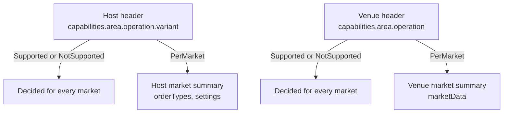

Exchanges differ. One can look an order up by your `clientOrderId` alone, another only together with its instrument. One market accepts market orders sized in quote currency, another only in contracts. One venue reports index prices, another does not.

Plurex does not hide these differences behind behaviour you have to discover. Every host and every venue publishes its **capabilities**: a complete, machine-readable statement of which operations and variants it supports, and every market publishes the rules and options that apply to it. Your program reads them once, decides what to call, and never needs trial and error or exchange-specific code.

## What capabilities promise

- **Nothing is left out.** Every operation and every variant always appears. Unsupported entries say `NotSupported` explicitly, so a missing field never has to be interpreted.
- **One shape everywhere.** Every host publishes the same tree, and every venue publishes the same tree. Code that reads one host's capabilities reads them all, including paper hosts.
- **Decide before calling.** If the capabilities say an operation is supported for a market and your inputs follow that market's published rules, Plurex passes the request to the host. If they say it is not supported, the call returns `422 NotSupported`. The host can still refuse a request for reasons no capability describes, such as insufficient funds.
- **Every option has its own flag.** Plurex never infers one capability from another. For example, `supportsPositionEffect` is independent of whether the market has a position mode setting.
- **Plurex validates exactly what it publishes.** Order rules are checked as published, and Plurex never rounds your inputs. See [Market order rules](/capabilities/order-rules).

## Where capabilities live

Capabilities come in two levels: the **header** of each host or venue, and the **summary** of each of its markets. All four are read with public discovery operations that need no API key. All of them are paged: follow `nextCursor` until it is `null`.

| Level | Field | Read with | Describes |
| --- | --- | --- | --- |
| Host header | `HostHeader.capabilities` | [List hosts](/api-reference/platform/hosts/list) | Order queries and commands, fills, market settings, the order stream and transactions |
| Host market | `HostMarketSummary.orderTypes`, `.settings`, `.contractDetails` | [List host markets](/api-reference/platform/hosts/list-markets) | Which order types the market accepts, each input's rules and options, leverage and position mode |
| Venue header | `VenueHeader.capabilities` | [List venues](/api-reference/platform/venues/list) | Order book, trades, prices, best quotes, statistics, funding, open interest and candles |
| Venue market | `VenueMarketSummary.marketData` | [List venue markets](/api-reference/platform/venues/list-markets) | Which market-data reads the market supports, and on what terms |

A venue market tells you what is trading. The matching host market tells you how you can trade it: the order types it accepts and their order rules. A host market names its venue in `venueId`, so you can join it to the venue market with the same `instrument`.



### The header: area, operation, variant, support

A header capability is a tree. Its first level is an **area** (`orders`, `fills`, `marketSettings`, `prices`, `candles`), under which are **operations** and, where an operation has them, its **variants**. Each leaf is a **support** value. A few areas add a level (`prices` has one entry per price kind) or skip one (`marketSettings.getMarketLeverage` has no variants), and the stream areas also carry plain values such as `changes` and `includesFillDetails`:

```json
"orders": {
  "getOrder": {
    "byId": { "type": "Supported" },
    "byClientOrderId": { "type": "NotSupported" },
    "byClientOrderIdForInstrument": { "type": "Supported" }
  }
}
```

Each leaf name is the lowerCamel form of the request variant's `type`. The leaf `orders.getOrder.byClientOrderIdForInstrument` gates a [GetOrder](/api-reference/platform/hosts/get-order) request whose `query.type` is `ByClientOrderIdForInstrument`; `orders.listClosedOrders.globalBefore` gates [ListClosedOrders](/api-reference/platform/hosts/list-closed-orders) with `query.type` `GlobalBefore`. All variants of one operation return the same result shape.

### The market: descriptors with nullable presence

Market summaries do not repeat the support values. They use **descriptors**:

- A descriptor that is `null` means the market does not support that thing at all. For example, `orderTypes.market: null` means no market orders on this market, and `settings.leverage: null` means the market has no leverage setting.
- A non-null descriptor carries the terms you need: increments, minimums, time-in-force sets, candle intervals, the statistics window.
- Inside a descriptor, each operation has its own flag: `get` for a read, `list` and `listBefore` for candles, and `setEffectScope` (non-null when the setting can be changed). A non-null descriptor can still have one of its flags `false`, so check the specific flag.

Order types are a special case: they have no header entry. Whether a market accepts `Market`, `TriggerLimit` or `TriggerMarket` orders is read only from that market's `orderTypes`.

## Support values

Every support leaf is an `OperationSupport`, or a `CursorQueryCapability` for variants that return pages. Both are unions on `type`.

| `type` | Meaning | What to do |
| --- | --- | --- |
| `Supported` | Supported on every market the host or venue lists, for every input. | Call it. |
| `PerMarket` | Supported on some markets. Used only for operations that take an instrument. | Read the market summary for the instrument. |
| `NotSupported` | Not supported. Calls return `422 NotSupported`. | Do not call it; use another variant or operation. |

`Supported` is a statement about the whole host or venue: it means every market the host lists, not every instrument that exists. `PerMarket` promises nothing about any particular market until you read that market's summary.

Paged variants (open and closed orders, fills, transactions, candles) use `CursorQueryCapability`. Its `Supported` case also states `defaultOrdering`: `Chronological` or `ReverseChronological`. That is the order results come in, within and across pages. Pages are read live, so items can change while you page.

```json
"listOpenOrders": {
  "global": { "type": "Supported", "defaultOrdering": "ReverseChronological" },
  "byInstrument": { "type": "Supported", "defaultOrdering": "ReverseChronological" }
}
```

### Partial results

Capabilities say whether you can call an operation, not how the host carries it out, so do not assume a batch operation is atomic. A batch can partly succeed, and the result tells you: [CancelOrders](/api-reference/platform/hosts/cancel-orders) returns one result per identifier, and [CancelAllOrders](/api-reference/platform/hosts/cancel-all-orders) returns `502 CancelAllFailed`, after which [ListOpenOrders](/api-reference/platform/hosts/list-orders) shows what is still open.

## Always supported

A minimal trading loop works on every host and every venue. These entries are always `Supported`; they still appear in the capabilities, so the tree stays complete.

| Where | Always supported |
| --- | --- |
| Every host market | Limit orders: `orderTypes.limit` is never `null` |
| Every host | `orders.getOrder.byId`, `orders.cancelOrder.byId` |
| Every venue | `orderBook.getOrderBook`, `trades.getRecentTrades` |

Some operations have no capability entry because every host offers them: [SubmitOrder](/api-reference/platform/hosts/submit-order) itself (the market's `orderTypes` say which order types it accepts), [ListWallets](/api-reference/platform/hosts/list-wallets), [ListOpenPositions](/api-reference/platform/hosts/list-positions), [ListAccountMarginStates](/api-reference/platform/hosts/list-margin-states), [GetAccountMarketState](/api-reference/platform/hosts/get-market-state), and the List and ListMarkets discovery operations.

Everything else is optional. In the API reference, optional operations carry the **Check capabilities** badge: "Not every host or venue supports this operation; check its capabilities first or expect 422 NotSupported." An operation without the badge, such as GetOrder or CancelOrder, can still have optional variants; their `byClientOrderId` variants are gated like any other.

## Can I do X on market M of host H?

Resolve any operation the same way: start at the header, and go to the market only when the header says `PerMarket` or when the operation has market-level terms.

```text
canDo(header, market, area, operation, variant, inputs):
    support = the header entry for this operation and variant      # always present; path depends on the area

    if support.type == "NotSupported":  return NO                 # the call returns 422 NotSupported
    if support.type not in ("Supported", "PerMarket"):
        return NO                                                  # a type you do not recognise

    if the operation takes no instrument:
        return support.type == "Supported"

    if market is null:  return NO                                  # the host or venue does not list it

    descriptor = the market's descriptor for this operation, if it has one
    if descriptor exists:
        if descriptor is null or its flag for this operation is false:  return NO
        if inputs break the descriptor's terms:  return NO          # the call returns 422 Rejected
        return YES

    return support.type == "Supported"                             # no market-level descriptor
```

SubmitOrder is the one exception to starting at the header: order types have no header leaf, so start at the market's `orderTypes`, and check the header's `orders.submitOrder.clientOrderId` only if you send a `clientOrderId`.

Which descriptor answers which operation:

| Operation | Market descriptor | Supported on the market when |
| --- | --- | --- |
| SubmitOrder | `orderTypes.limit`, `.market`, `.triggerLimit`, `.triggerMarket` | The order type's entry is non-null (`limit` always is) |
| GetMarketLeverage / SetMarketLeverage | `settings.leverage` | Non-null and `get` is `true` / `setEffectScope` is non-null |
| GetMarketPositionMode / SetMarketPositionMode | `settings.positionMode` | Non-null and `get` is `true` / `setEffectScope` is non-null |
| GetPrices (per price kind) | `marketData.prices.traded`, `.mark`, `.index` | Non-null and `get` is `true` |
| GetBestQuotes, GetMarketStatistics, GetIndicativeFundings, GetOpenInterests | `marketData.bestQuote`, `.statistics`, `.indicativeFunding`, `.openInterest` | Non-null and `get` is `true` |
| ListCandles (per price kind) | `marketData.candles.traded`, `.mark`, `.index` | Non-null, `list` (for `ByInstrument`) or `listBefore` (for `ByInstrumentBefore`) is `true`, and the interval is in `supportedIntervals` |

The same idea as a Python sketch, for host market settings:

```python
from decimal import Decimal

def support_type(header, area, operation, variant=None):
    entry = header["capabilities"][area][operation]
    return (entry[variant] if variant else entry)["type"]

def can_set_leverage(host, market, leverage: Decimal):
    if market is None:
        return False                      # the host does not list this market
    if support_type(host, "marketSettings", "setMarketLeverage") != "PerMarket":
        return False                      # NotSupported, or a value you do not recognise
    spec = market["settings"]["leverage"]
    if spec is None or spec["setEffectScope"] is None:
        return False                      # 422 NotSupported on this market
    lo, hi, step = Decimal(spec["min"]), Decimal(spec["max"]), Decimal(spec["step"])
    if lo == hi:
        return leverage == lo             # a single fixed leverage
    return lo <= leverage <= hi and (leverage - lo) % step == 0   # off the grid is 422 Rejected

def can_get_order_by_client_id(host):
    return support_type(host, "orders", "getOrder", "byClientOrderId") == "Supported"
```

Use `Decimal` (or your language's exact decimal type) for every comparison. Values arrive as JSON strings such as `"0.01"`; binary floating point will misjudge whole multiples.

<Note>
Today, market settings in the host header are always `PerMarket` or `NotSupported`, because settings are described per market. Venue market-data reads other than the order book and trades are likewise `PerMarket` or `NotSupported`. Write your resolver for the general case anyway; it costs nothing.
</Note>

## NotSupported and Rejected

Both are HTTP `422`, and they mean different things.

| Code | Means | Typical causes | What to do |
| --- | --- | --- | --- |
| `NotSupported` | The host or venue does not offer this operation, variant or order type, or (for venue reads and market settings) does not list the market. | A header entry is `NotSupported`; a market descriptor is `null` or its flag is `false`; a candle interval or price kind the market does not list. | Do not retry unchanged. Choose another variant or skip the market, and refresh capabilities. |
| `Rejected` | The operation is offered, but the inputs break the market's rules, or the host rejected the command. | A price off the increment, a size below `min`, `postOnly` where `supportsPostOnly` is `false`, a leverage off the grid. | Fix the inputs. The error `message` describes the problem. |

Submit orders only for markets the host lists in [List host markets](/api-reference/platform/hosts/list-markets); do not expect `NotSupported` for an order on an unlisted market.

Batch market-data reads never fail as a whole because one market lacks support. [GetPrices](/api-reference/platform/venues/get-prices) and the other batch reads return one result per instrument, and an unsupported instrument comes back as `{"type": "Unavailable", "code": "NotSupported", ...}`. See [Venue capabilities](/capabilities/venue-capabilities#batch-reads-and-single-market-reads).

The full list of codes is in [Errors](/api-reference/platform/errors).

## Caching and refreshing

Capabilities and market summaries are safe to cache, but they are not constants. Markets are listed and delisted, hosts add support, order rules and leverage ranges change, and a paper host's supported transaction types can grow while it runs.

- Load headers and the market summaries you trade at startup.
- Refresh them periodically. How often depends on your tolerance for stale rules; for most systems, minutes to hours is enough.
- After a `422 NotSupported` on a call your cache said was supported, reload the relevant header and market summary before deciding again.
- After a `422 Rejected` on order inputs you built from cached rules, reload the market summary: an increment or minimum may have changed.
- Never hard-code rules from an example or from an earlier response.

## Unknown values

Plurex adds enum values, union variants and fields over time without a new API version. Write capability code that survives this:

- Ignore fields you do not recognise.
- Treat a `type` you do not recognise, in a support value or anywhere else, as unsupported for your purposes rather than as an error.
- Treat unknown enum values in sets such as `supportedTimeInForce`, `supportedTransactionTypes` or `supportedIntervals` as values you will not use.
- Send only values the market's capability sets list. Requests are strict: an enum value the API does not define returns `400 InvalidRequest`, and a defined value the market does not list returns `422`.

## Paper hosts

A paper host publishes its own capabilities, read the same way. Its markets follow the order rules of the real host it simulates, named in `modelHostId`, but its operations and options can differ from that host's in both directions. Read the paper host's capabilities while you paper trade, and the model host's before you go live. See [Paper trading](/paper/overview) and [Going live](/paper/going-live).

## In depth

<CardGroup cols={3}>
  <Card title="Host capabilities" icon="server" href="/capabilities/host-capabilities">
    Every order, fill, settings, stream and transaction capability, and what each one gates.
  </Card>
  <Card title="Market order rules" icon="ruler" href="/capabilities/order-rules">
    Order types, per-input rules, options, triggers and settings on each host market.
  </Card>
  <Card title="Venue capabilities" icon="chart-line" href="/capabilities/venue-capabilities">
    Which market-data reads each venue and market supports, and on what terms.
  </Card>
</CardGroup>
