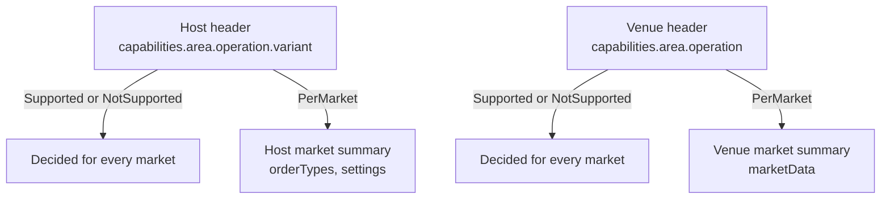

Exchanges differ. One can look an order up by your `clientOrderId` alone, another only together with its instrument. One market accepts market orders sized in quote currency, another only in contracts. One venue reports index prices, another does not.

Every host and venue publishes its **capabilities**: a complete, machine-readable statement of which operations and variants it supports. Every market publishes the rules and options that apply to it. Your code reads them and decides what to call, with no trial and error and no exchange-specific code.

## What capabilities promise

- **Nothing is left out.** Every capability always appears. Unsupported ones say `NotSupported`, and operations every host or venue offers are [listed below](#always-supported).
- **One shape everywhere.** All hosts, paper hosts included, publish the same structure, and so do all venues. Code that reads one reads them all.
- **Decide before calling.** If the capabilities say an operation is supported for a market and your inputs follow that market's published rules, Plurex passes the request to the host. If they say it is not supported, the call returns `422 NotSupported`. The host can still refuse a request for reasons no capability describes, such as insufficient funds.
- **Every option has its own flag.** Plurex never infers one capability from another.
- **Plurex validates exactly what it publishes.** Order rules are checked as published, and Plurex never rounds your inputs. See [Market order rules](/capabilities/order-rules).

## Where capabilities live

Capabilities come in two levels: the **header** of each host or venue, and the **summary** of each of its markets. All four operations below are paged: follow `nextCursor` until it is `null`.

| Level | Field | Read with | Describes |
| --- | --- | --- | --- |
| [Host header](/capabilities/host-capabilities) | `HostHeader.capabilities` | [List hosts](/api-reference/platform/hosts/list) | Orders, fills, market settings, the order stream and transactions |
| [Host market](/capabilities/order-rules) | `HostMarketSummary.orderTypes`, `.settings`, `.contractDetails` | [List host markets](/api-reference/platform/hosts/list-markets) | The order types the market accepts, their rules and options, leverage and position mode |
| [Venue header](/capabilities/venue-capabilities) | `VenueHeader.capabilities` | [List venues](/api-reference/platform/venues/list) | Market-data reads and streams |
| [Venue market](/capabilities/venue-capabilities#market-data-on-each-market) | `VenueMarketSummary.marketData` | [List venue markets](/api-reference/platform/venues/list-markets) | Which of those the market supports, and on what terms |

A venue market tells you what is trading. The host market tells you how you can trade it. A host market names its venue in `venueId`, so you can join the two on `instrument`.



### The header: area, operation, variant, support

Header capabilities are grouped by **area** (`orders`, `fills`, `marketSettings`, `prices`, `candles`). An area holds **operations**, and an operation holds its **variants**, if it has any. Each operation or variant has a **support** value. A few areas add a level (`prices` has one entry per price kind) or skip one (`marketSettings.getMarketLeverage` has no variants), and `accountTransactions` also carries a plain value, `supportedTransactionTypes`:

```json
"orders": {
  "getOrder": {
    "byId": { "type": "Supported" },
    "byClientOrderId": { "type": "NotSupported" },
    "byClientOrderIdForInstrument": { "type": "Supported" }
  }
}
```

A variant's capability is named with the lowerCamel form of the request variant's `type`: `orders.getOrder.byClientOrderIdForInstrument` gates a [GetOrder](/api-reference/platform/hosts/get-order) request whose `query.type` is `ByClientOrderIdForInstrument`.

### The market: descriptors with nullable presence

Market summaries do not repeat the support values. They use **descriptors**:

- A descriptor that is `null` means the market does not support that thing at all. For example, `orderTypes.market: null` means no market orders on this market, and `settings.leverage: null` means the market has no leverage setting.
- A non-null descriptor carries the terms you need: increments, minimums, time-in-force sets, candle intervals, the statistics window.
- Inside a descriptor, each operation has its own flag: `get` for a read, `subscribe` for a stream, `list` and `listBefore` for candles, `list` for funding history, and `setEffectScope` (non-null when the setting can be changed). A non-null descriptor can still have one of its flags `false`, so check the specific flag.

## Support values

Every support value is a union on `type`. Which union depends on who decides support:

| Union | Used for | Its `type` values |
| --- | --- | --- |
| `OperationSupport` | Operations and variants the host or venue offers on all of its markets or on none | `Supported`, `NotSupported` |
| `CursorQueryCapability` | Paged host variants: open and closed orders, fills, transactions | `Supported` (with `defaultOrdering`), `NotSupported` |
| `MarketSupport` | Operations that belong to a market: market settings, and every venue read and stream except the L2 order book and trades, including candles and funding history | `PerMarket`, `NotSupported` |

| `type` | Meaning | What to do |
| --- | --- | --- |
| `Supported` | Supported on every market the host or venue lists, for every input. | Call it. |
| `PerMarket` | The host or venue offers it, and each market says whether that market supports it. | Read the market summary for the instrument. |
| `NotSupported` | Not supported. Calls return `422 NotSupported`. | Do not call it; use another variant or operation. |

`Supported` means every market the host or venue lists, not every instrument that exists. `PerMarket` promises nothing about a market until you read its summary.

`CursorQueryCapability`'s `Supported` case also states `defaultOrdering`, the order results come in within and across pages: `ReverseChronological` (newest first) or `Chronological` (oldest first). Candles and funding periods have no `defaultOrdering`: they always come newest first.

### Partial results

Capabilities say whether you can call an operation, not how the host carries it out, so do not assume a batch is atomic. A batch can partly succeed: [CancelOrders](/api-reference/platform/hosts/cancel-orders) returns one result per identifier, and [CancelAllOrders](/api-reference/platform/hosts/cancel-all-orders) returns `502 CancelAllFailed`, after which [ListOpenOrders](/api-reference/platform/hosts/list-orders) shows what is still open.

## Always supported

A minimal trading loop works on every host and every venue.

| Where | Always supported |
| --- | --- |
| Every host market | Limit orders: `orderTypes.limit` is never `null` |
| Every host | `orders.getOrder.byId`, `orders.cancelOrder.byId` |
| Every venue | `orderBookL2.getOrderBookL2`, `orderBookL2.subscribeToOrderBookL2s`, `trades.getRecentTrades`, `trades.subscribeToTrades` |

Some operations have no capability entry because every host offers them: [SubmitOrder](/api-reference/platform/hosts/submit-order) itself (the market's `orderTypes` say which order types it accepts), [ListWallets](/api-reference/platform/hosts/list-wallets), [ListOpenPositions](/api-reference/platform/hosts/list-positions), [ListAccountMarginStates](/api-reference/platform/hosts/list-margin-states), [GetAccountMarketState](/api-reference/platform/hosts/get-market-state), and the List and ListMarkets discovery operations. ListAccountMarginStates can still return `422 NotSupported` for an account margin mode the host does not support, because the account decides that, not the host.

Everything else is optional. In the API reference, optional operations carry the **Check capabilities** badge, and the **Check support** block on each host and venue operation names the capabilities to read. An operation without the badge, such as GetOrder or CancelOrder, can still have optional variants, such as `byClientOrderId`.

## Can I do X on market M of host H?

Resolve any operation the same way: start at the header, and go to the market only when the header says `PerMarket` or when the operation has market-level terms.

```text
canDo(header, market, area, operation, variant, inputs):
    support = the header entry for this operation and variant      # always present; path depends on the area

    if support.type == "NotSupported":  return NO                 # the call returns 422 NotSupported
    if support.type not in ("Supported", "PerMarket"):
        return NO                                                  # a type you do not recognise

    if the operation takes no instrument:
        return support.type == "Supported"

    if market is null:  return NO                                  # the host or venue does not list it

    descriptor = the market's descriptor for this operation, if it has one
    if descriptor exists:
        if descriptor is null or its flag for this operation is false:  return NO
        if inputs break the descriptor's terms:  return NO          # the call returns 422 Rejected
        return YES

    return support.type == "Supported"                             # no market-level descriptor
```

SubmitOrder is the one exception to starting at the header: order types have no header capability, so start at the market's `orderTypes`, and check the header's `orders.submitOrder.clientOrderId` only if you send a `clientOrderId`.

Which descriptor answers which operation:

| Operation | Market descriptor | Supported on the market when |
| --- | --- | --- |
| SubmitOrder | `orderTypes.limit`, `.market`, `.triggerLimit`, `.triggerMarket` | The order type's entry is non-null (`limit` always is) |
| GetMarketLeverage / SetMarketLeverage | `settings.leverage` | Non-null and `get` is `true` / `setEffectScope` is non-null |
| GetMarketPositionMode / SetMarketPositionMode | `settings.positionMode` | Non-null and `get` is `true` / `setEffectScope` is non-null |
| GetPrice (per price kind) | `marketData.prices.traded`, `.mark`, `.index` | Non-null and `get` is `true` |
| GetOrderBookL1, GetMarketStatistics, GetIndicativeFunding, GetOpenInterest | `marketData.orderBookL1`, `.statistics`, `.indicativeFunding`, `.openInterest` | Non-null and `get` is `true` |
| The matching streams (SubscribeToPrices, SubscribeToOrderBookL1s and so on) | The same descriptor | Non-null and `subscribe` is `true` |
| ListCandles (per price kind) | `marketData.candles.traded`, `.mark`, `.index` | Non-null, `list` (for `ByInstrument`) or `listBefore` (for `ByInstrumentBefore`) is `true`, and the interval is in `supportedIntervals` |
| SubscribeToCandles (per price kind) | `marketData.candles.traded`, `.mark`, `.index` | Non-null, `subscribe` is `true`, and the interval is in `supportedIntervals` |
| ListFundingPeriods | `marketData.fundingPeriods` | Non-null and `list` is `true` |

The same idea as a Python sketch, for host market settings:

```python
from decimal import Decimal

def support_type(header, area, operation, variant=None):
    entry = header["capabilities"][area][operation]
    return (entry[variant] if variant else entry)["type"]

def can_set_leverage(host, market, leverage: Decimal):
    if market is None:
        return False                      # the host does not list this market
    if support_type(host, "marketSettings", "setMarketLeverage") != "PerMarket":
        return False                      # NotSupported, or a value you do not recognise
    spec = market["settings"]["leverage"]
    if spec is None or spec["setEffectScope"] is None:
        return False                      # 422 NotSupported on this market
    lo, hi, step = Decimal(spec["min"]), Decimal(spec["max"]), Decimal(spec["step"])
    if lo == hi:
        return leverage == lo             # a single fixed leverage
    return lo <= leverage <= hi and (leverage - lo) % step == 0   # off the grid is 422 Rejected

def can_get_order_by_client_id(host):
    return support_type(host, "orders", "getOrder", "byClientOrderId") == "Supported"
```

Use `Decimal` (or your language's exact decimal type) for every comparison. Values arrive as JSON strings such as `"0.01"`; binary floating point will misjudge whole multiples.

## NotSupported and Rejected

Both are HTTP `422`, and they mean different things.

| Code | Means | Typical causes | What to do |
| --- | --- | --- | --- |
| `NotSupported` | The host or venue does not offer this operation, variant or order type, or does not list the market. | A header entry is `NotSupported`; a market descriptor is `null` or its flag is `false`; a candle interval or price kind the market does not list. | Do not retry unchanged. Choose another variant or skip the market, and refresh capabilities. |
| `Rejected` | The operation is offered, but the inputs break the market's rules, or the host rejected the command. | A price off the increment, a size below `min`, `postOnly` where `supportsPostOnly` is `false`, a leverage off the grid. | Fix the inputs. The error `message` describes the problem. |

The full list of codes is in [Errors](/api-reference/platform/errors).

## Caching and refreshing

Capabilities and market summaries are safe to cache, but they change: markets are listed and delisted, hosts add support, order rules and leverage ranges change, and a paper host's supported transaction types can grow while it runs.

- Load headers and the market summaries you trade at startup.
- Refresh them periodically. How often depends on your tolerance for stale rules; for most systems, minutes to hours is enough.
- After a `422 NotSupported` on a call your cache said was supported, reload the relevant header and market summary before deciding again.
- After a `422 Rejected` on order inputs you built from cached rules, reload the market summary: an increment or minimum may have changed.
- Never hard-code rules from an example or from an earlier response.

## Unknown values

Plurex adds values without a new API version; see [Compatibility](/api-reference/platform/conventions#compatibility). In capability code:

- Treat a `type` you do not recognise, in a support value or anywhere else, as unsupported rather than as an error.
- Treat unknown values in sets such as `supportedTimeInForce`, `supportedTransactionTypes` or `supportedIntervals` as values you will not use.
- Send only values the market's capability sets list: an enum value the API does not define returns `400 InvalidRequest`, and a defined value the market does not list returns `422`.

## Paper hosts

A paper host publishes its own capabilities, read the same way. Its markets follow the order rules of its model host (`modelHostId`), but its operations and options can differ from that host's in both directions. Read the paper host's capabilities while you paper trade, and the model host's before you go live. See [Paper trading](/paper/overview) and [Going live](/paper/going-live).

## In depth

<CardGroup cols={3}>
  <Card title="Host capabilities" icon="server" href="/capabilities/host-capabilities">
    Every order, fill, settings, stream and transaction capability, and what each one gates.
  </Card>
  <Card title="Market order rules" icon="ruler" href="/capabilities/order-rules">
    Order types, per-input rules, options, triggers and settings on each host market.
  </Card>
  <Card title="Venue capabilities" icon="chart-line" href="/capabilities/venue-capabilities">
    Which market-data reads each venue and market supports, and on what terms.
  </Card>
</CardGroup>
