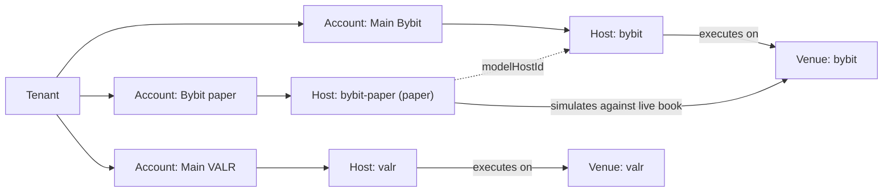

Plurex splits every exchange into two concerns that most exchange APIs mix together:

- A **[venue](/concepts/venues)** is where markets trade and prices form. Venue operations are market data: what is trading and at what price.
- A **[host](/concepts/hosts)** is the institution that holds trading accounts and executes orders on a venue's markets. Host operations cover executing trades, and everything about your account: orders, fills, balances, positions, margin, market settings and transactions.

Read market data from the venue. Trade through the host. A venue market tells you what is trading; the matching host market tells you how you can trade it.

## How the pieces fit

You act as your **tenant**. The tenant owns **accounts**, each account lives on exactly one host, and each host executes on one or more venues. A **paper host** simulates a real host (its **model host**) against the live order book of the same venue.



| Object | What it is | How you find it |
| --- | --- | --- |
| Tenant | The owner of your accounts and API keys. | Your tenant ID is on the DevTools page of the Plurex app. |
| Account | Your account on one host: connected with exchange API credentials, or a paper account. | [List accounts](/api-reference/platform/accounts/list) |
| Host | Holds accounts and executes orders. Real hosts are exchanges' account services; paper hosts simulate a real host. | [List hosts](/api-reference/platform/hosts/list) |
| Venue | Where markets trade. Publishes order books, trades, prices and other market data. | [List venues](/api-reference/platform/venues/list) |

See [Tenants and accounts](/concepts/accounts) for ownership and the account lifecycle.

## Why Plurex separates venues and hosts

Many exchanges are both a venue and a host: Bybit runs the market and also holds your Bybit account. Plurex still models them separately, and that shapes how you call the API:

- **Market data is the same for everyone; account data is private.** Market data is named by venue and instrument. Account operations identify everything from the `accountId`, never from a venue.
- **Several hosts can trade one venue.** The `bybit` venue is traded by both the `bybit` host and the `bybit-paper` host. A paper host executes nothing for real: it simulates its model host against the venue's live order book, under the model host's order rules, so your paper and real accounts see the same market. [From backtest to live](/how-plurex-works#from-backtest-to-live) shows how a strategy moves between them.
- **Venue increments are not order rules.** A venue's `increments` are the grid it quotes on, for formatting prices and grouping book levels. Only a host can say what it will accept, so always size and price orders from the host market. See [Order rules](/capabilities/order-rules).

## Joining a venue market to a host market

Every host market names the venue it trades on in `venueId`, and carries the same `instrument` and canonical `symbol` as the venue market. The pair `venueId` + `instrument` is the join.

For example, [List host markets](/api-reference/platform/hosts/list-markets) on the `bybit` host returns a market with:

| Field | Value |
| --- | --- |
| `venueId` | `"bybit"` |
| `symbol` | `"BTC-USDT-PERP"` |
| `instrument` | `{ "type": "Perp", "base": "BTC", "quote": "USDT" }` |

To read its mark price, send the same `venueId` and `instrument` to [Get a price](/api-reference/platform/venues/get-price):

```json
{
  "venueId": "bybit",
  "kind": "Mark",
  "instrument": { "type": "Perp", "base": "BTC", "quote": "USDT" }
}
```

The `symbol` is identical on both summaries, so it works as a display name and a map key, but you never send it: every operation takes the structured `instrument`. See [Instruments and sizing](/concepts/instruments).

## Venues and hosts compared

| | Venue | Host |
| --- | --- | --- |
| Answers | What is trading, and at what price? | How do I trade here, and what are my positions and balances? |
| Markets | [Venue markets](/api-reference/platform/venues/list-markets): instrument, contract details, increments and which market data each market reports | [Host markets](/api-reference/platform/hosts/list-markets): instrument, contract details, order types, order rules and settings such as leverage and position mode |
| Data and actions | L2 and L1 order books, recent trades, prices by kind, statistics, indicative funding, open interest, candles, funding history | Orders, fills, wallets, positions, margin, per-market account state, leverage, position mode, transactions, account streams |
| Capabilities | `VenueCapabilities` on each venue | `ExecutionHostCapabilities` on each host |

When hosts or venues differ, the difference is in their capabilities and market summaries, so read them before you call. See [Capabilities](/capabilities/overview).

## What exists today

Plurex currently supports **Bybit** and **VALR** as venues and hosts, with a paper host for each, with IDs such as `bybit`, `valr`, `bybit-paper` and `valr-paper`. The current venues list spot and perpetual markets.

Do not hard-code these lists. Discover venues and hosts at runtime, and filter to what your strategy needs:

```bash
curl --request QUERY https://api.plurex.io/api/v1/hosts/query/List \
  --header 'Content-Type: application/json' \
  --header "X-API-KEY: $PLUREX_API_KEY" \
  --header "X-API-SECRET: $PLUREX_API_SECRET" \
  --data '{}'
```

Both listings are paged: follow `nextCursor` until it is `null`. [Hosts](/concepts/hosts#the-host-header) describes what each host carries.

## Next

<CardGroup cols={2}>
  <Card title="Venues" href="/concepts/venues">
    Venue markets, order books, observations, freshness, candles and funding history.
  </Card>
  <Card title="Hosts" href="/concepts/hosts">
    Host markets, orders, fills, portfolio, market settings and transactions.
  </Card>
  <Card title="Tenants and accounts" href="/concepts/accounts">
    Who owns what, connecting accounts and creating paper accounts.
  </Card>
  <Card title="Instruments and sizing" href="/concepts/instruments">
    Structured instruments, canonical symbols and native contract sizes.
  </Card>
</CardGroup>
