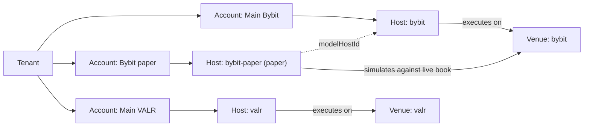

Plurex is one API across many exchanges. To make that work without hiding how they differ, it splits every trading venue into two concerns that most exchange APIs mix together:

- A **venue** is where markets trade and prices form. Venue operations are public market data: what is trading and at what price.
- A **host** is the institution that holds trading accounts and executes orders on a venue's markets. Host operations cover what you may order, and everything about your account: orders, fills, balances, positions, margin, market settings and transactions.

Read market data from the venue. Trade through the host. A venue market tells you what is trading; the matching host market tells you what you may order there.

## How the pieces fit

You act as your **tenant**. The tenant owns **accounts**, each account lives on exactly one host, and each host executes on one or more venues. A **paper host** simulates a real host (its **model host**) against the live order book of the same venue.



| Object | What it is | How you find it |
| --- | --- | --- |
| Tenant | The owner of your accounts and API keys. | Your tenant ID is on the DevTools page of the Plurex app. |
| Account | Your account on one host: connected with exchange API credentials, or a paper account. | [List accounts](/api-reference/platform/accounts/list) |
| Host | Holds accounts and executes orders. Real hosts are exchanges' account services; paper hosts simulate a real host. | [List hosts](/api-reference/platform/hosts/list) |
| Venue | Where markets trade. Publishes order books, trades, prices and other market data. | [List venues](/api-reference/platform/venues/list) |

See [Tenants and accounts](/concepts/accounts) for ownership and the account lifecycle.

## Why Plurex separates venues and hosts

Many exchanges are both a venue and a host: Bybit runs the market and also holds your Bybit account. Plurex still models them separately, because the two concerns answer different questions and do not always come from the same place.

**The concerns differ.** Market data is public, shared by everyone and changes by the millisecond. Account data is private, belongs to one account and is governed by the institution that holds it. Keeping them apart means market data needs no API key, and account operations identify everything from the `accountId` (with your API key), never from a venue.

**Hosts can trade venues they do not run.** The model allows a host that trades a venue it does not operate, as a broker does. Today the case you will meet is the paper host: it executes nothing for real, and simulates its model host against the venue's live order book. The market data comes from the venue, and the account and order handling come from the host.

**Several hosts can trade one venue.** Today the `bybit` venue is traded by both the `bybit` host and the `bybit-paper` host. Both read the same venue for prices, and the paper host follows the real host's order rules for the markets it simulates. Your paper account and your real account see the same market.

**Venue increments are not order rules.** A venue publishes `increments`, the grid its order book and trades are quoted on, so you can format prices and group book levels. Only a host places orders, so only a host can say what it will accept: order types, price and size increments, minimum size, minimum value and options such as `postOnly` or `reduceOnly`. Always size and price orders from the host market, never from the venue market. See [Order rules](/capabilities/order-rules).

## Joining a venue market to a host market

Every host market names the venue it trades on in `venueId`, and carries the same `instrument` and canonical `symbol` as the venue market. The pair `venueId` + `instrument` is the join.

For example, [List host markets](/api-reference/platform/hosts/list-markets) on the `bybit` host returns a market with:

| Field | Value |
| --- | --- |
| `venueId` | `"bybit"` |
| `symbol` | `"BTC-USDT-PERP"` |
| `instrument` | `{ "type": "Perp", "base": "BTC", "quote": "USDT" }` |

To read its mark price, send the same `venueId` and `instrument` to [Get prices](/api-reference/platform/venues/get-prices):

```json
{
  "venueId": "bybit",
  "kind": "Mark",
  "instruments": [{ "type": "Perp", "base": "BTC", "quote": "USDT" }]
}
```

The `symbol` is identical on both summaries, so it works as a display name and a map key. You never send it as input: every operation takes the structured `instrument`. See [Instruments and sizing](/concepts/instruments).

## What you get from each

| | Venue | Host |
| --- | --- | --- |
| Answers | What is trading, and at what price? | What may I order here, and what does my account hold? |
| Discover | [List venues](/api-reference/platform/venues/list) | [List hosts](/api-reference/platform/hosts/list) |
| Markets | [Venue markets](/api-reference/platform/venues/list-markets): instrument, contract details, increments and which market data each market reports | [Host markets](/api-reference/platform/hosts/list-markets): instrument, contract details, order types, order rules and settings such as leverage and position mode |
| Data and actions | Order books, recent trades, prices by kind, best quotes, statistics, indicative funding, open interest, candles | Orders, fills, wallets, positions, margin, per-market account state, leverage, position mode, transactions, account streams |
| Capabilities | `VenueCapabilities` on each venue | `ExecutionHostCapabilities` on each host |
| API key | Never needed | Not needed to list hosts and host markets; needed for every account operation |

Each venue and host declares what it supports. When hosts differ, the difference is in their capabilities and market summaries, not hidden behind a lowest common denominator or papered over with guesses. Read them before you call. See [Capabilities](/capabilities/overview).

## What exists today

Plurex currently offers venues and hosts for **Bybit** and **VALR**, and a paper host for each, with IDs such as `bybit`, `valr`, `bybit-paper` and `valr-paper`. The current venues list spot and perpetual markets.

Do not hard-code these lists. Discover venues and hosts at runtime, and filter to what your strategy needs:

```bash
curl --request POST https://api.plurex.io/api/v1/hosts/query/List \
  --header 'Content-Type: application/json' \
  --data '{}'
```

Each host in the response carries its `id`, `venueIds`, `isPaper`, `modelHostId` (the real host a paper host simulates, `null` for a real host), `supportedCredentialTypes` and `capabilities`. Both listings are paged: follow `nextCursor` until it is `null`.

## From your backtest to live trading

Plurex is an execution layer. It does not build or backtest strategies; it gives a strategy you built and backtested elsewhere one API for every stage that follows:

1. **Forward test on paper.** Create a paper account on a paper host. It fills your orders against the venue's live order book, with the model host's markets and order rules, and simulates fees and perpetual funding. No real money moves.
2. **Go live.** Connect an account on the model host and use its `accountId` instead. Orders, fills, positions and streams use the same operations and shapes.
3. **Go wider.** Add accounts on other hosts. The same code reads each host's capabilities and order rules and adapts to them.

Paper and real hosts publish their own capabilities, so check the real host's before you switch. See [Paper trading](/paper/overview) and [Going live](/paper/going-live).

## Next

<CardGroup cols={2}>
  <Card title="Venues" href="/concepts/venues">
    Venue markets, order books, observations, freshness and candles.
  </Card>
  <Card title="Hosts" href="/concepts/hosts">
    Host markets, orders, fills, portfolio, market settings and transactions.
  </Card>
  <Card title="Tenants and accounts" href="/concepts/accounts">
    Who owns what, connecting accounts and creating paper accounts.
  </Card>
  <Card title="Instruments and sizing" href="/concepts/instruments">
    Structured instruments, canonical symbols and native contract sizes.
  </Card>
</CardGroup>
