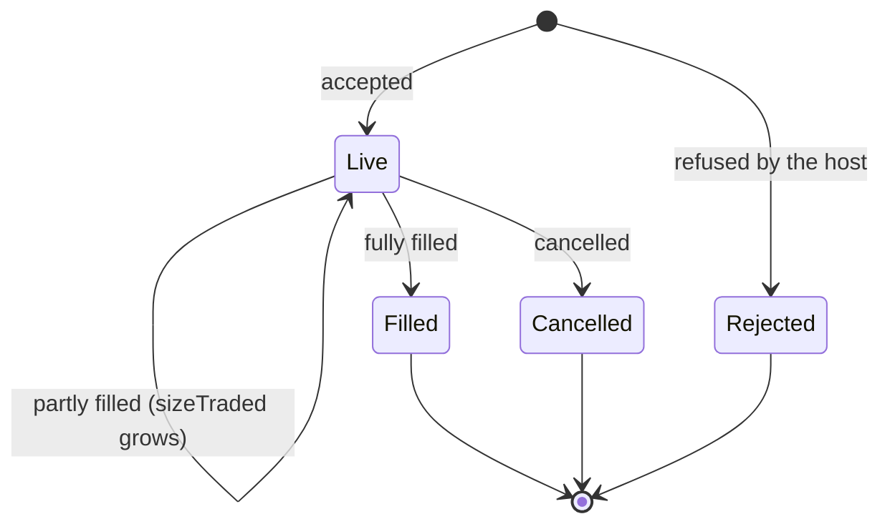
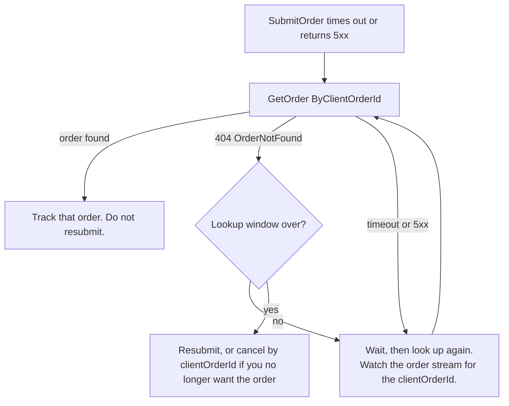

Every account, real or paper, places and manages orders through the same host operations. This guide covers what to check before you submit, how to submit each order type, how to follow an order to its final state, and how to recover when you cannot tell whether a command took effect.

The examples use a BTC/USDT perpetual and the host ID `bybit`. Discover the hosts and markets available to you with [List hosts](/api-reference/platform/hosts/list) and [List host markets](/api-reference/platform/hosts/list-markets), and find an account's host with [Get an account](/api-reference/platform/accounts/get).

## Before you submit

An order is valid only if it fits the host market's order rules. Plurex checks your order against exactly the rules it publishes and never rounds your values, so read them first.

<Steps>
  <Step title="Find the host market">
    Call [List host markets](/api-reference/platform/hosts/list-markets) with the account's `hostId` and filters such as `base`, `quote` and `types`. Order rules come from the host market, never from the venue market. A market the host does not list cannot be traded on that host.
  </Step>
  <Step title="Check the order type">
    `orderTypes.limit` is always present. `market`, `triggerLimit` and `triggerMarket` are `null` when the market does not support that type; submitting one anyway returns `422 NotSupported`.
  </Step>
  <Step title="Fit price and size to the rules">
    Prices are whole multiples of `price.increment`, sizes are whole multiples of `size.increment` and at least `size.min`, and a priced order's value must reach `value.min`. Sizes are in native contracts, so read `contractDetails` before converting an amount of money into a size. An order that breaks a rule returns `422 Rejected`.
  </Step>
  <Step title="Check the options you send">
    `tif` must be in `options.supportedTimeInForce`. Send `postOnly: true`, `reduceOnly: true` or a non-null `positionEffect` only when the matching `supportsPostOnly`, `supportsReduceOnly` or `supportsPositionEffect` flag is `true`.
  </Step>
  <Step title="Check clientOrderId support">
    Send a `clientOrderId` only when the host's `capabilities.orders.submitOrder.clientOrderId` is supported. To recover from an unclear submission you also need `getOrder.byClientOrderId` or `getOrder.byClientOrderIdForInstrument`.
  </Step>
</Steps>

This is the limit-order entry of a perpetual market (example values; read the live ones from the market):

```json
{
  "price": { "increment": "0.1" },
  "size": { "increment": "0.001", "min": "0.001" },
  "value": { "min": "5" },
  "options": {
    "supportsReduceOnly": true,
    "supportedTimeInForce": ["GTC", "IOC", "FOK"],
    "supportsPostOnly": true,
    "supportsPositionEffect": true
  }
}
```

[Order rules](/capabilities/order-rules) explains every rule, including the value calculation for inverse markets and how to round in the right direction.

<Tip>
  Choose a `clientOrderId` that is unique per order, so a lookup by it finds exactly one order. Plurex does not publish length or character rules for it; a short value of letters, digits and hyphens is the safest choice.
</Tip>

## Submit an order

[Submit an order](/api-reference/platform/hosts/submit-order) takes the `accountId` and one `order`, whose `type` is `Limit`, `Market`, `TriggerLimit` or `TriggerMarket`. Every order has an `instrument`, a `side` (`Buy` or `Sell`) and `reduceOnly`. There is no leverage field on an order: leverage is a market setting (see [Balances, positions and settings](/guides/portfolio#leverage)).

### Limit order

A limit order needs `size`, `price` and `tif`. `postOnly` defaults to `false`.

```json
{
  "accountId": "acc_123",
  "order": {
    "type": "Limit",
    "instrument": { "type": "Perp", "base": "BTC", "quote": "USDT" },
    "side": "Buy",
    "size": "0.010",
    "price": "60000.0",
    "reduceOnly": false,
    "tif": "GTC",
    "postOnly": true,
    "clientOrderId": "grid-buy-0042"
  }
}
```

### Market order by size or by notional

A market order carries `sizing` instead of `size` and `price`. `Size` is in native contracts; `Notional` is an amount of the quote asset. Each side lists the units it accepts in `orderTypes.market.sizingSupport.buy` and `.sell`. `tif` defaults to `IOC` and must still be in the market's `supportedTimeInForce`.

```json
{
  "accountId": "acc_123",
  "order": {
    "type": "Market",
    "instrument": { "type": "Perp", "base": "BTC", "quote": "USDT" },
    "side": "Sell",
    "sizing": { "type": "Size", "size": "0.010" },
    "reduceOnly": false,
    "clientOrderId": "exit-0042"
  }
}
```

To spend a fixed amount of quote, size by notional where the side supports it:

```json
{
  "accountId": "acc_123",
  "order": {
    "type": "Market",
    "instrument": { "type": "Spot", "base": "BTC", "quote": "USDT" },
    "side": "Buy",
    "sizing": { "type": "Notional", "notional": "250" },
    "reduceOnly": false,
    "tif": "IOC"
  }
}
```

A notional is not a size promise: the size you receive is the notional divided by the fill price, and can fall below the market's minimum size. When `notional.increment` is `null` the host may round the amount itself; the returned order's `sizing` shows what it accepted when the host reports it.

### Trigger orders

`TriggerLimit` and `TriggerMarket` wait until the reference price meets the trigger condition, then place a limit or market order. Read the market's `trigger` entry first:

- `trigger.price` follows `trigger.price.increment`.
- `condition` is `RefPriceGTE` (the reference is at or above the price) or `RefPriceLTE` (at or below it), and must be listed in `buyConditions` or `sellConditions` for your side. Choose a trigger price on the far side of the current reference: if the condition is already met when you submit, what happens is up to the host.
- When `referencePrice` is `UserSelectable`, send a `reference` from its `prices` list. When it is `HostSelected`, the host fixes the reference: omit `reference`.

A trigger limit buy that enters on a breakout:

```json
{
  "accountId": "acc_123",
  "order": {
    "type": "TriggerLimit",
    "instrument": { "type": "Perp", "base": "BTC", "quote": "USDT" },
    "side": "Buy",
    "size": "0.010",
    "price": "66050.0",
    "reduceOnly": false,
    "tif": "GTC",
    "trigger": { "price": "66000.0", "condition": "RefPriceGTE", "reference": "LastTrade" },
    "clientOrderId": "breakout-0042"
  }
}
```

A stop-loss for a long position is a trigger market sell with `reduceOnly: true`, so it can only shrink the position:

```json
{
  "accountId": "acc_123",
  "order": {
    "type": "TriggerMarket",
    "instrument": { "type": "Perp", "base": "BTC", "quote": "USDT" },
    "side": "Sell",
    "sizing": { "type": "Size", "size": "0.010" },
    "reduceOnly": true,
    "trigger": { "price": "58000.0", "condition": "RefPriceLTE", "reference": "Mark" },
    "clientOrderId": "stop-0042"
  }
}
```

### What the response means

A successful response is the order as the host accepted it:

```json
{
  "data": {
    "type": "Limit",
    "id": "ord_789",
    "createdAt": "2026-10-25T09:30:00Z",
    "side": "Buy",
    "instrument": { "type": "Perp", "base": "BTC", "quote": "USDT" },
    "state": "Live",
    "sizeTraded": "0",
    "averagePrice": null,
    "realizedPnl": null,
    "totalFees": [],
    "clientOrderId": "grid-buy-0042",
    "size": "0.010",
    "price": "60000.0"
  }
}
```

Keep `id`: every later lookup and cancel can use it. The order records what the host reports. Submitted options (`tif`, `postOnly`, `reduceOnly`, `positionEffect`) are not echoed, and `averagePrice` and `realizedPnl` are `null` when the host does not report them. Plurex does not calculate an average price from fills.

## Order states

An order is in one of four states. `Live` is the only one that can change.



| State | Meaning |
| --- | --- |
| `Live` | Working on the host. An untriggered trigger order is `Live`. A partly filled order stays `Live` with `sizeTraded` greater than zero. |
| `Filled` | Completely filled. |
| `Cancelled` | No longer working. Check `sizeTraded`: a cancelled order may have partly filled first. |
| `Rejected` | Refused by the host. |

There is no separate partly-filled state and no `updatedAt`. Compare `sizeTraded` with the order's size to see progress.

## Track orders

| To find | Use | Notes |
| --- | --- | --- |
| One order | [Get an order](/api-reference/platform/hosts/get-order) | `ById` works on every host. `ByClientOrderId` and `ByClientOrderIdForInstrument` depend on `getOrder` capabilities. |
| Several named orders | [Get orders](/api-reference/platform/hosts/get-orders) | Batch. Unknown identifiers are left out of the result, not reported as errors. |
| Everything still working | [List open orders](/api-reference/platform/hosts/list-orders) | `Global` or `ByInstrument`. Paged. |
| Finished orders | [List closed orders](/api-reference/platform/hosts/list-closed-orders) | Filled, cancelled and rejected orders: `Global` or `ByInstrument`, optionally from a `Before` or `After` time. Paged. |
| Individual executions | [List fills](/api-reference/platform/hosts/list-fills) | `ByOrderId`, `ByInstrument` or `Global`. Paged. |
| Changes as they happen | [Stream account orders](/api-reference/platform/hosts/subscribe-to-account-orders) | See [Stream account updates](/guides/streams). |

Look up by client order ID:

```json
{
  "accountId": "acc_123",
  "query": { "type": "ByClientOrderId", "clientOrderId": "grid-buy-0042" }
}
```

Where the host supports only the instrument-scoped variant, use `ByClientOrderIdForInstrument`:

```json
{
  "accountId": "acc_123",
  "query": {
    "type": "ByClientOrderIdForInstrument",
    "instrument": { "type": "Perp", "base": "BTC", "quote": "USDT" },
    "clientOrderId": "grid-buy-0042"
  }
}
```

Read several orders at once with `GetOrders`. Because unknown identifiers are omitted, compare the result with what you asked for:

```json
{
  "accountId": "acc_123",
  "query": { "type": "ByIds", "orderIds": ["ord_789", "ord_790", "ord_791"] }
}
```

The list operations are paged: omit `cursor` for the first page, then send each `nextCursor` back with the same query until it is `null`. Each variant's capability entry gives its `defaultOrdering`. Every list operation, and each of its variants, is optional, so check `listOpenOrders`, `listClosedOrders` and `fills.listFills` in the host's capabilities first.

A fill gives the price, size, fees and, when the host reports them, its execution `id` and `role` (`Maker` or `Taker`). Its `side` is your order's side, not the taker's.

## Cancel orders

### Cancel one order

[Cancel an order](/api-reference/platform/hosts/cancel-order) accepts `ById` on every host, plus `ByClientOrderId` and `ByClientOrderIdForInstrument` where `cancelOrder` capabilities say so:

```json
{
  "accountId": "acc_123",
  "command": { "type": "ById", "orderId": "ord_789" }
}
```

A success is an empty acknowledgement, `{}`. It means the host accepted the cancel, not that the order is closed: some hosts cancel asynchronously, and the order can fill before the cancel lands. Confirm the final state with [Get an order](/api-reference/platform/hosts/get-order) or the order stream. Cancelling is safe to repeat.

| Response | What it tells you | What to do |
| --- | --- | --- |
| `200` `{}` | The host accepted the cancel. | Confirm the final state. |
| `404 OrderNotFound` | The host does not know this identifier as an open order: it never existed, it closed and the host forgot it, or it is not visible yet. | Not a success. Check with `GetOrder` or `ListOpenOrders`. |
| `409 OrderAlreadyClosed` | The order already finished. It may have filled. | Do not retry. Read the order to see how it ended. |

### Cancel several orders

[Cancel orders](/api-reference/platform/hosts/cancel-orders) takes a list of IDs or client order IDs and returns one result per identifier, so it can partly succeed:

```json
{
  "accountId": "acc_123",
  "command": { "type": "ByIds", "orderIds": ["ord_789", "ord_790"] }
}
```

```json
{
  "data": [
    { "type": "Cancelled", "identifier": "ord_789" },
    { "type": "Failed", "identifier": "ord_790", "code": "OrderAlreadyClosed", "message": "Order already closed" }
  ]
}
```

Check every result. A `Failed` result carries the code a single cancel would have returned, with the same meaning. `RateLimited`, `Unavailable`, `UpstreamTimeout` and `UpstreamFailure` are transient, so retry those identifiers. `Rejected` and `NotSupported` mean the request must change. Errors that stop the whole batch, such as a missing account, come back as an ordinary error response.

### Cancel everything

[Cancel all orders](/api-reference/platform/hosts/cancel-all-orders) cancels every open order on the account (`Global`) or on one instrument (`ByInstrument`):

```json
{
  "accountId": "acc_123",
  "command": {
    "type": "ByInstrument",
    "instrument": { "type": "Perp", "base": "BTC", "quote": "USDT" }
  }
}
```

Success means no matching orders remain open; orders that were already gone or closed count as cancelled. Any other failure returns `502 CancelAllFailed`, after which [List open orders](/api-reference/platform/hosts/list-orders) shows what is still open. It is safe to repeat.

## Handle an unclear outcome

A timeout, a dropped connection or a `5xx` response from `SubmitOrder` does not tell you whether the order was placed. Submitting again may place a second order. A `4xx` response means the request needs to change; on its own it does not prove the order was never placed (see [Errors](/api-reference/platform/errors)).



1. Always send a `clientOrderId` when the host supports it. Without one, you can only search `ListOpenOrders` and `ListClosedOrders` for an order that matches.
2. Look the order up with `GetOrder` `ByClientOrderId`, or `ByClientOrderIdForInstrument` if that is the variant the host supports.
3. If the order is found, it was placed. Track it; do not resubmit.
4. `404 OrderNotFound` is not proof that the order was never placed: the host may not show it yet. Retry the lookup a few times with a growing delay, and if you are connected to the order stream, watch for an event whose order carries your client order ID.
5. Resubmit only when you are satisfied the order does not exist. `409 DuplicateClientOrderId` means an open order already holds that client order ID: look it up and track it. Reusing the client order ID of an order that has already filled or been cancelled may place a new order, so do not rely on `409` to catch duplicates. Use a unique `clientOrderId` for every order you intend to place, and always complete the lookup before you resubmit.

### Cancel an order whose ID you never received

If you no longer want the order, you do not need its ID. Where `cancelOrder.byClientOrderId` or `cancelOrder.byClientOrderIdForInstrument` is supported, cancel by client order ID:

```json
{
  "accountId": "acc_123",
  "command": { "type": "ByClientOrderId", "clientOrderId": "grid-buy-0042" }
}
```

Read the result the same way as any cancel. `OrderAlreadyClosed` means the order existed and finished, possibly filled, so do not resubmit it. `OrderNotFound` still leaves the question open; look the order up again before deciding.

## Worked example

This flow places a limit order on a paper or real account, confirms it, cancels it and checks the result. It assumes `PLUREX_API_KEY`, `PLUREX_API_SECRET` and `PLUREX_ACCOUNT_ID` are set.

<Steps>
  <Step title="Read the market's order rules">
    ```bash
    curl --request POST https://api.plurex.io/api/v1/hosts/query/ListMarkets \
      --header 'Content-Type: application/json' \
      --data '{"hostId": "bybit", "base": "BTC", "quote": "USDT", "types": ["Perp"]}'
    ```

    Use the `hostId` of the account you trade (from [Get an account](/api-reference/platform/accounts/get)); for a paper account that is the paper host, not the real one. Take `orderTypes.limit` from the BTC-USDT-PERP market and check the price and size you plan to send against it.
  </Step>
  <Step title="Submit with a client order ID">
    ```bash
    curl --request POST https://api.plurex.io/api/v1/hosts/command/SubmitOrder \
      --header 'Content-Type: application/json' \
      --header "X-API-KEY: $PLUREX_API_KEY" \
      --header "X-API-SECRET: $PLUREX_API_SECRET" \
      --data @- <<EOF
    {
      "accountId": "$PLUREX_ACCOUNT_ID",
      "order": {
        "type": "Limit",
        "instrument": {"type": "Perp", "base": "BTC", "quote": "USDT"},
        "side": "Buy",
        "size": "0.010",
        "price": "60000.0",
        "reduceOnly": false,
        "tif": "GTC",
        "clientOrderId": "guide-0001"
      }
    }
    EOF
    ```

    If this call times out, go straight to the next step: it tells you whether the order exists.
  </Step>
  <Step title="Confirm the order">
    ```bash
    curl --request POST https://api.plurex.io/api/v1/hosts/query/GetOrder \
      --header 'Content-Type: application/json' \
      --header "X-API-KEY: $PLUREX_API_KEY" \
      --header "X-API-SECRET: $PLUREX_API_SECRET" \
      --data @- <<EOF
    {"accountId": "$PLUREX_ACCOUNT_ID", "query": {"type": "ByClientOrderId", "clientOrderId": "guide-0001"}}
    EOF
    ```
  </Step>
  <Step title="Cancel it">
    ```bash
    curl --request POST https://api.plurex.io/api/v1/hosts/command/CancelOrder \
      --header 'Content-Type: application/json' \
      --header "X-API-KEY: $PLUREX_API_KEY" \
      --header "X-API-SECRET: $PLUREX_API_SECRET" \
      --data @- <<EOF
    {"accountId": "$PLUREX_ACCOUNT_ID", "command": {"type": "ById", "orderId": "ORDER_ID_FROM_STEP_2"}}
    EOF
    ```
  </Step>
  <Step title="Confirm the final state">
    Repeat the `GetOrder` call until `state` is no longer `Live`. Expect `Cancelled`, or `Filled` if the order filled before the cancel took effect.
  </Step>
</Steps>

## Related

- [Order rules](/capabilities/order-rules): every rule a market publishes and how to meet it.
- [Host capabilities](/capabilities/host-capabilities): which operations and variants a host supports.
- [Stream account updates](/guides/streams): follow orders without polling.
- [Errors](/api-reference/platform/errors): every error code and the retry rules for each operation.
