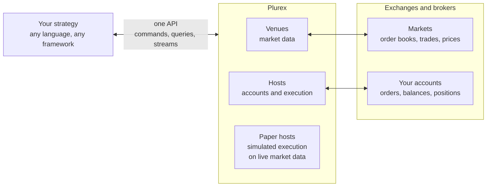

Plurex sits between your strategy and the markets it trades. Your strategy talks to one API, and every value it gets back is either what the exchange said or explicitly unknown.

## One API across venues and hosts

Plurex models trading with four ideas:

| Concept | Question it answers | Examples of what it covers |
| --- | --- | --- |
| [Venue](/concepts/venues) | What is trading, and at what price? | Markets, order books, public trades, prices, statistics, funding rates, open interest, candles |
| [Host](/concepts/hosts) | How do I execute trades, and what are my positions and balances? | Order types and rules, orders, fills, balances, positions, margin, leverage, transactions |
| [Account](/concepts/accounts) | Which of my accounts am I acting on? | A connected exchange account, or a paper account |
| [Tenant](/concepts/accounts) | Who owns the accounts and API keys? | Accounts and API keys |

A venue's market is where liquidity and prices are. A host holds your account and executes your orders there. One exchange is often both, but not always: a paper host trades a venue it doesn't run, and several hosts can trade the same venue. See [Venues and hosts](/concepts/venues-and-hosts).

Every account is on exactly one host. A strategy can run several accounts side by side, with the same calls, order model and error codes on every host.

## Commands, queries and streams

Every operation is one of three kinds:

- A **query** reads state, such as listing markets or getting an order. Queries are always safe to repeat.
- A **command** changes state, such as submitting or cancelling an order. Each command says whether it is safe to repeat, because in trading a retry can mean a second order.
- A **stream** follows one topic and sends you its changes as they happen, such as a market's order book or an account's orders. Most streams start with the current state.

Commands are `POST`. Queries and streams are `QUERY` ([RFC 10008](https://www.rfc-editor.org/rfc/rfc10008)), a safe method that carries a body. Every operation takes a JSON body at a path that names it, such as `/api/v1/hosts/command/SubmitOrder`. There are no `GET`, `PUT` or `DELETE` resources, and IDs never go in the path, because:

- **Operations are trading actions, not resources.** `CancelAllOrders` on one instrument, or `GetOrder` by `clientOrderId`, don't map cleanly onto HTTP verbs and URLs.
- **Requests are typed.** Instruments, order types and lookup variants are structured JSON with a `type` field, which query strings can't express unambiguously.
- **Retry safety is in the method and path.** `QUERY` tells your retry logic it may repeat; `POST` means check the command.

Unlike GraphQL, you don't choose fields: each operation returns every field every time, with `null` where the host doesn't report a value.

The [OpenAPI specification](/api-reference/platform/overview#specification) describes every operation and stream, so you can generate a client in any language.

## Self-describing by design

Exchanges differ in which order types they offer, how they size orders, whether they can look up an order by your own ID, and which market data they publish. Plurex declares these differences instead of hiding them behind a lowest common denominator.

- **Every host and venue publishes its capabilities.** These say which operations and variants are supported everywhere, on some markets, or not at all.
- **Every market publishes its rules.** A host market lists the order types it accepts and, for each one, its rules and options. A venue market lists the market data it serves.
- **Plurex validates exactly what it publishes.** It rejects an order that breaks the market's published rules with a clear error, and never rounds or adjusts the order for you. The host can still reject an order for reasons no rule describes, such as insufficient funds or a size limit the market doesn't publish.

Your program can decide from data which order types to use, how to round a price, or whether a market has mark-price candles. See [Capabilities](/capabilities/overview).

## Unambiguous data

Plurex promises only what every supported host can keep:

- A field is non-null only when every host reports it truthfully. Otherwise it can be `null`, and its description says when.
- Plurex never invents data. It doesn't calculate an average price the host didn't report, invent an execution ID, or infer an order's sizing unit from its fills.
- Prices keep their kind. A mark price is never relabelled as a traded price. If a venue stops reporting a value, it is cleared rather than served stale.
- Sizes are always in the market's [native contracts](/concepts/instruments#size-is-always-native-contracts), and every decimal is an exact string.
- Responses only grow. New fields, enum values, variants and error codes can be added without a new API version. See [Compatibility](/api-reference/platform/conventions#compatibility).

## High-fidelity paper trading

A paper host simulates a real host on that host's venue, using the venue's live market data. Paper accounts use exactly the same host operations and streams as real accounts.

- **Orders.** Marketable orders fill against the live order book's depth, one fill per price level, so large orders see realistic slippage, and depth your account takes is used up. Resting orders wait behind the visible queue and fill as live public trades work through it. Trigger orders fire on the live reference price they name.
- **Wallets and collateral.** Wallets hold and lock funds as the host does, and perpetual collateral is a weighted, multi-asset pool modelled on the host's account.
- **Fees and funding.** Trading fees follow the exchange's published tier you choose, and perpetual positions pay and receive funding at the venue's funding times, from its finalised rates. See [Fees and funding](/paper/fees-and-funding).
- **Order rules.** Paper markets follow the order rules of the host they simulate. The paper host publishes its own capabilities, and [From paper to live](/paper/going-live) lists the differences, such as leverage and liquidation.

Read [Paper trading](/paper/overview) for the full model.

## From backtest to live

Plurex doesn't run backtests; use whatever research tools you like. It takes over where a backtest ends:

<Steps>
  <Step title="Forward test on paper">
    Create a paper account on the paper host for the exchange you plan to trade, fund it and run your strategy against live markets with no risk.
  </Step>
  <Step title="Span venues and hosts">
    Run paper accounts on several hosts at once to test strategies that trade across venues.
  </Step>
  <Step title="Switch to live">
    Connect a real account on the host the paper host simulates (its `modelHostId`), point your strategy at the new account ID, and re-read the live host's capabilities. The API calls, the models and the order rules of the host you simulated stay the same. Plan for [the differences](/paper/going-live), such as leverage and order options.
  </Step>
</Steps>

## What Plurex is not

- **Not a strategy framework.** Your strategy logic lives in your code.
- **Not a backtester or historical data store.** Candle history is limited: before the start of the history available, a page of candles is empty.
- **Not a lowest common denominator.** If one host offers something another doesn't, Plurex exposes it and declares where it is available.

## Next steps

<CardGroup cols={2}>
  <Card title="Quickstart" icon="rocket" href="/quickstart">
    Make your first calls and place a paper order.
  </Card>
  <Card title="Venues and hosts" icon="building-columns" href="/concepts/venues-and-hosts">
    The two halves of the trading ecosystem, in depth.
  </Card>
</CardGroup>
