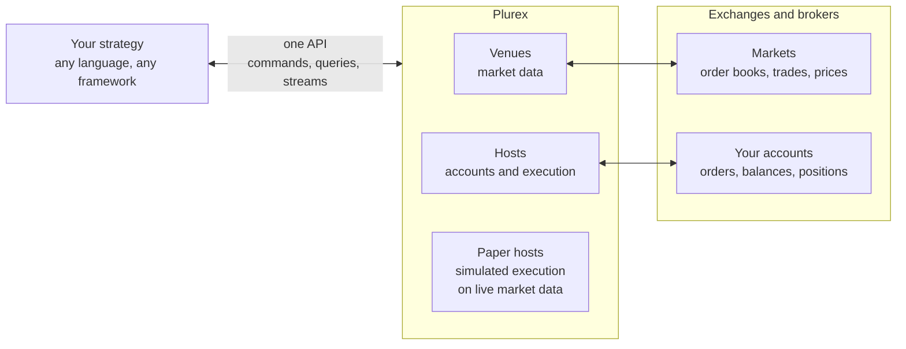

Plurex sits between your strategy and the markets it trades. Your strategy talks to one API. Plurex talks to each exchange in that exchange's own terms, and it either describes what comes back exactly or tells you the exchange doesn't report it.

## One API across venues and hosts

Plurex models trading with four ideas. Each one answers a different question.

| Concept | Question it answers | Examples of what it covers |
| --- | --- | --- |
| [Venue](/concepts/venues) | What is trading, and at what price? | Markets, order books, public trades, prices, statistics, funding, open interest, candles |
| [Host](/concepts/hosts) | How do I execute trades, and what are my positions and balances? | Order types and rules, orders, fills, balances, positions, margin, leverage, transactions |
| [Account](/concepts/accounts) | Which of my accounts am I acting on? | A connected exchange account, or a paper account |
| [Tenant](/concepts/accounts) | Who owns the accounts and API keys? | Accounts and API keys |

Venues and hosts are separate because they are separate concerns. A venue's market is where liquidity and prices are. A host is the institution that holds your account and executes your orders there. One exchange is often both, but not always: a paper host trades a venue it doesn't run, and several hosts can trade the same venue. Keeping them apart means market data never pretends to be an order rule, and an order rule always comes from the host that enforces it. [Venues and hosts](/concepts/venues-and-hosts) covers this in depth.

Every account is on exactly one host, and every operation on an account works the same way whatever the host. A strategy that trades several hosts uses the same calls, the same order model and the same error codes for all of them. It can run several accounts side by side.

## Commands, queries and streams

Every operation is one of three kinds:

- A **query** reads state, such as listing markets or getting an order. Queries are always safe to repeat.
- A **command** changes state, such as submitting or cancelling an order. Each command says whether it is safe to repeat, because in trading a retry can mean a second order.
- A **stream** pushes changes on your accounts to you over WebSocket: order changes and transactions.

Queries and commands are HTTP `POST` requests with a JSON body, sent to a path that names the operation, such as `/api/v1/hosts/command/SubmitOrder`. There are no `GET`, `PUT` or `DELETE` resources, and IDs never go in the path. This is deliberate:

- **Operations are trading actions, not resources.** `CancelAllOrders` on one instrument, or `GetOrder` by `clientOrderId`, don't map cleanly onto HTTP verbs and URLs, so each operation is named for what it does.
- **Requests are typed.** Instruments, order types and lookup variants are structured JSON with a `type` field, which query strings can't express unambiguously.
- **Retry safety is in the path.** `query` or `command` tells your retry logic what it may repeat.
- **Responses have a fixed shape.** Unlike GraphQL, you don't choose fields: each operation returns every field every time, with `null` where the host doesn't report a value, and has its own capability entry and errors.

The [OpenAPI and AsyncAPI specifications](/api-reference/platform/overview#specifications) describe every operation and stream, so you can generate a client in any language.

## Self-describing by design

Exchanges differ in which order types they offer, how they size orders, whether they can look up an order by your own ID, and which market data they publish. Plurex doesn't hide these differences behind a lowest common denominator, and it doesn't paper over them with guesses. It declares them.

- **Every host and venue publishes its capabilities.** These list every operation and variant, each marked as supported everywhere, supported on some markets, or not supported. Nothing is left out, so a missing entry never has to be interpreted.
- **Every market publishes its rules.** A host market lists the order types it accepts and, for each one, the price, size, notional and value rules and the options it allows. A venue market lists the market data it serves.
- **Plurex validates exactly what it publishes.** It checks your order against the market's published rules and rejects one that breaks them with a clear error. It never rounds or adjusts the order for you. The host can still reject an order for reasons no rule describes, such as insufficient funds or a size limit the market doesn't publish.

So your program can make every decision from data: which order types to use, how to round a price, whether it can cancel by client order ID, or whether a market has mark-price candles. Read [Capabilities](/capabilities/overview) to see how.

## Unambiguous data

Plurex is an aggregate of many hosts, so it promises only what every supported host can keep:

- A field is non-null only when every host reports it truthfully. Otherwise it can be `null`, and its description says when.
- Plurex never invents data. It doesn't calculate an average price the host didn't report, invent an execution ID, echo back options the host didn't confirm, or infer an order's sizing unit from its fills.
- Prices keep their kind. A mark price is never relabelled as a traded price or derived from another kind. If a venue stops reporting a value, it is cleared rather than served stale.
- Sizes are always in the market's [native contracts](/concepts/instruments#size-is-always-native-contracts), and every decimal is an exact string.
- Responses only grow. New fields, enum values, variants and error codes can be added without a new API version, and the API tells you to tolerate them.

The result is a model you can trust in code: a value is either what the exchange said, or explicitly unknown.

## High-fidelity paper trading

A paper host simulates a real host on that host's venue, using the venue's live market data. Paper accounts use exactly the same host operations and streams as real accounts.

- Market orders and marketable limit orders fill against the live order book's depth, so large orders see realistic slippage.
- Resting orders wait behind the visible queue at their price, and fill as live public trades work through it.
- Trigger orders fire on the live reference price they name.
- Wallets hold and lock funds as the host does, and perpetual collateral is a weighted, multi-asset pool modelled on the host's account, valued at live prices.
- Trading fees follow a fee tier you choose. Perpetual positions pay and receive funding at the venue's funding times, from its finalised rates, with the position valued at a price estimated from the mark price. See [Fees and funding](/paper/fees-and-funding).
- Paper markets follow the order rules of the host they simulate. Anything paper can't simulate is left out, and the paper host publishes its own capabilities so your program can see exactly what it supports. [From paper to live](/paper/going-live) lists the differences, such as leverage and liquidation.

Read [Paper trading](/paper/overview) for the full model.

## From backtest to live

Plurex doesn't run backtests. Use whatever research tools you like for that. Plurex takes over where a backtest ends:

<Steps>
  <Step title="Forward test on paper">
    Create a paper account on the paper host for the exchange you plan to trade, fund it and run your strategy against live markets with no risk. Your strategy reads capabilities and market rules the same way it will in production.
  </Step>
  <Step title="Span venues and hosts">
    Run paper accounts on several hosts at once to test strategies that trade across venues, with the same code path for each.
  </Step>
  <Step title="Switch to live">
    Connect a real account on the host the paper host simulates (its `modelHostId`), and point your strategy at the new account ID. The API calls, the models and the order rules of the host you simulated stay the same: change the account, then re-read the live host's capabilities. [From paper to live](/paper/going-live) lists the differences to plan for, such as leverage and order options.
  </Step>
</Steps>

## What Plurex is not

- **Not a strategy framework.** Plurex places and tracks orders and serves market data. Your strategy logic lives in your code.
- **Not a backtester or historical data store.** Candle history is limited: each market declares how far back each interval reaches where a limit applies (`maxHistoryAgeByInterval`).
- **Not a lowest common denominator.** If one host offers something another doesn't, Plurex exposes it and declares where it is available, so you don't lose a host's strengths to keep your code portable.

## Next steps

<CardGroup cols={2}>
  <Card title="Quickstart" icon="rocket" href="/quickstart">
    Make your first calls and place a paper order.
  </Card>
  <Card title="Venues and hosts" icon="building-columns" href="/concepts/venues-and-hosts">
    The two halves of the trading ecosystem, in depth.
  </Card>
</CardGroup>
