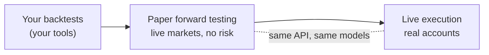

Plurex is an execution layer for systematic trading. It gives your strategies one API across exchanges and the hosts that hold your accounts. It adds a high-fidelity paper trading engine that runs against live markets, and a path from your own backtests to forward testing to real execution with the same API calls, the same models, and the order rules of the host it simulates.

Plurex doesn't care how you build your strategy. Any language, framework, data stack or research tooling works. It is a general-purpose utility: send it orders, and it tells you exactly what each venue and host can do.

## What Plurex gives you

<CardGroup cols={3}>
  <Card title="An aggregated API" icon="layer-group" href="/how-plurex-works#one-api-across-venues-and-hosts">
    One model for markets, orders, fills, balances, positions and transactions, on every venue and host Plurex supports.
  </Card>
  <Card title="High-fidelity paper trading" icon="flask" href="/paper/overview">
    Orders fill against the live order book with depth and queue modelling. Fees and perpetual funding are simulated too.
  </Card>
  <Card title="A seamless path to live" icon="route" href="/paper/going-live">
    Forward test on paper, then change the account to a real one on the host it simulates and re-read that host's capabilities. You use the same calls and models.
  </Card>
</CardGroup>

## Built for programs

Plurex is designed to be used by software, not just read by people.

- **Self-describing.** Every host and venue publishes its [capabilities](/capabilities/overview): each operation it supports, each order type and option, and each market's order rules. Your program can decide what to call before calling it.
- **No leaky abstractions.** Exchanges differ, and Plurex never hides it. Where hosts behave differently, the difference is declared in their capabilities, not smoothed over or approximated.
- **Unambiguous data.** Every value is either reported by the host or venue, or explicitly `null`. Plurex never estimates, backfills or relabels data. A mark price is never presented as a traded price, and an average price is never calculated from fills.
- **Exact numbers.** Prices, sizes and balances are exact decimal strings. Sizes are always in the market's native contracts, and Plurex validates exactly the rules it publishes, without rounding for you.

## Start here

<CardGroup cols={2}>
  <Card title="Quickstart" icon="rocket" href="/quickstart">
    Discover markets, create a paper account and place your first order.
  </Card>
  <Card title="How Plurex works" icon="diagram-project" href="/how-plurex-works">
    The model behind the API: venues, hosts, accounts, paper hosts and capabilities.
  </Card>
  <Card title="Venues and hosts" icon="building-columns" href="/concepts/venues-and-hosts">
    Why market data and execution are separate concerns, and how they fit together.
  </Card>
  <Card title="Capabilities" icon="list-check" href="/capabilities/overview">
    Read what each host, venue and market supports, and build valid orders from it.
  </Card>
</CardGroup>

## Use the platform

<CardGroup cols={2}>
  <Card title="API reference" icon="code" href="/api-reference/platform/overview">
    Every operation and stream, generated from the Plurex OpenAPI and AsyncAPI specifications.
  </Card>
  <Card title="Web app" icon="laptop" href="/platform/overview">
    Manage accounts and API keys, and trade manually with the same order rules as the API.
  </Card>
</CardGroup>
