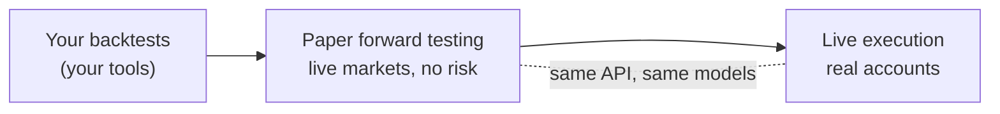

Plurex is an execution layer for systematic trading. It gives your strategies one API across exchanges and the hosts that hold your accounts, and it does two things most trading APIs do not:

- It is **fully self-describing and unambiguous**, so one integration copes with every host and venue without exchange-specific code.
- It has **high-fidelity paper trading** against live markets, so you can forward test many strategy variants side by side, without risk, and take the winners live with the same calls.

Plurex is agnostic to how you build your strategy: any language, framework, data stack or research tooling works. Your strategy reads what each venue and host supports, then places and manages its orders through one API.

## Write your strategy once, not once per exchange

Exchanges differ: in the order types they accept, how you find an order, what their streams report, and which settings you can change. Most cross-exchange APIs hide those differences, and the hiding is never complete. You find the gaps in production, and you end up with exchange-specific code in your own integration to work around them.

Plurex takes the opposite approach. It is fully self-describing and unambiguous, so differences become data your program reads, not surprises it discovers:

- **Self-describing.** Every host and venue publishes its [capabilities](/capabilities/overview): each operation and variant it supports, each order type and option, and each market's [order rules](/capabilities/order-rules). Your program can decide what to call before calling it.
- **No leaky abstractions.** Where hosts behave differently, the difference is declared in their capabilities, not smoothed over or approximated.
- **Unambiguous data.** Every value is either reported by the host or venue, or explicitly `null`. Plurex never estimates, backfills or relabels data. A mark price is never presented as a traded price, and an average price is never calculated from fills.
- **Exact numbers.** Prices, sizes and balances are exact decimal strings. Sizes are always in the market's native contracts, and Plurex validates exactly the rules it publishes, without rounding for you.

So instead of branching on which exchange you are talking to, your strategy branches on what the host says it can do: whether to send a `clientOrderId`, how to find an order after a timeout, whether to read fills from the order stream or poll for them. One integration handles every host and venue, including ones you add later.

## High-fidelity paper trading, at scale

A backtest gives you an instant answer about the past. A forward test gives you an answer about the market as it is now, but only as fast as the market moves: a month of evidence takes a month. You cannot speed that up, so the way to choose between strategies, parameters or sizing before going live is to forward test them side by side.

Plurex paper trading is built for that:

- **Fills that behave like the market.** Orders match against the venue's live order book. Marketable orders walk the visible depth, one fill per price level, and use up the depth they take; resting orders join the queue behind the size already at their price and fill as public trades work through it. Trigger orders watch the live last trade, best bid or ask, mark or index price. See [How orders fill](/paper/overview#how-orders-fill).
- **The real host's account model.** Fee tiers follow the exchange's published schedule, VIP tiers included, perpetual collateral is a weighted, multi-asset pool like the host's, and funding is paid at the venue's real funding times from its finalised rates.
- **The real host's order rules.** A paper market has the same instruments, increments, minimums and value floors as the real host it simulates, so your strategy builds orders on paper exactly as it will live.
- **As many accounts as you need.** Run each variant on its own paper account, side by side, with no capital at risk.
- **The same code, live.** A paper account is an ordinary account. When a variant earns it, switch to a real account on the host it simulates and re-read that host's capabilities. See [From paper to live](/paper/going-live).

## Start here

<CardGroup cols={2}>
  <Card title="Quickstart" icon="rocket" href="/quickstart">
    Discover markets, create a paper account and place your first order.
  </Card>
  <Card title="How Plurex works" icon="diagram-project" href="/how-plurex-works">
    The model behind the API: venues, hosts, accounts, paper hosts and capabilities.
  </Card>
  <Card title="Venues and hosts" icon="building-columns" href="/concepts/venues-and-hosts">
    Why market data and execution are separate concerns, and how they fit together.
  </Card>
  <Card title="Capabilities" icon="list-check" href="/capabilities/overview">
    Read what each host, venue and market supports, and build valid orders from it.
  </Card>
</CardGroup>

## Use the platform

<CardGroup cols={2}>
  <Card title="API reference" icon="code" href="/api-reference/platform/overview">
    Every operation and stream, generated from the Plurex OpenAPI specification.
  </Card>
  <Card title="Web app" icon="laptop" href="/platform/overview">
    Manage accounts and API keys, and trade manually with the same order rules as the API.
  </Card>
</CardGroup>
