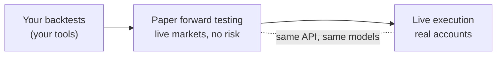

Plurex is an execution layer for systematic trading: one API across exchanges and the hosts that hold your accounts. Two things set it apart:

- It is **fully self-describing and unambiguous**, so one integration copes with every host and venue without exchange-specific code.
- It has **high-fidelity paper trading** against live markets, so you can forward test many strategy variants side by side, without risk, and take the winners live with the same calls.

Build your strategy with any language, framework, data stack or research tooling.

## Write your strategy once, not once per exchange

Exchanges differ in the order types they accept, how you find an order, what their streams report and which settings you can change. Most cross-exchange APIs hide those differences, and you find the gaps in production. Plurex turns them into data your program reads:

- **Self-describing.** Every host and venue publishes its [capabilities](/capabilities/overview): the operations and variants it supports, each order type and option, and each market's [order rules](/capabilities/order-rules).
- **No leaky abstractions.** Where hosts behave differently, the difference is declared, not smoothed over or approximated.
- **Unambiguous data.** Every value is either reported by the host or venue, or explicitly `null`. Plurex never estimates, backfills or relabels data.
- **Exact numbers.** Prices, sizes and balances are exact decimal strings. Sizes are always in the market's native contracts, and Plurex validates exactly the rules it publishes, without rounding for you.

Your strategy branches on what the host says it can do, not on which exchange it is talking to: whether to send a `clientOrderId`, how to find an order after a timeout, whether a market lets you set its leverage.

## High-fidelity paper trading, at scale

A forward test only moves as fast as the market: a month of evidence takes a month. To choose between strategies, parameters or sizing before going live, forward test them side by side.

- **Fills that behave like the market.** Orders match against the venue's live order book. Marketable orders walk the visible depth and use up what they take; resting orders join the queue behind the size already at their price and fill as public trades work through it. See [How orders fill](/paper/overview#how-orders-fill).
- **The real host's account model.** Fee tiers follow the exchange's published schedule, VIP tiers included, perpetual collateral is a weighted, multi-asset pool like the host's, and funding is paid at the venue's real funding times from its finalised rates. An account's transactions reconcile to its wallets.
- **The real host's order rules.** A paper market has the same instruments, increments, minimums and value floors as the real host it simulates.
- **As many accounts as you need.** Run each variant on its own paper account, with no capital at risk.
- **The same code, live.** A paper account is an ordinary account. When a variant earns it, switch to a real account on the host it simulates and re-read that host's capabilities. See [From paper to live](/paper/going-live).

## Start here

<CardGroup cols={2}>
  <Card title="Quickstart" icon="rocket" href="/quickstart">
    Discover markets, create a paper account and place your first order.
  </Card>
  <Card title="How Plurex works" icon="diagram-project" href="/how-plurex-works">
    The model behind the API: venues, hosts, accounts, paper hosts and capabilities.
  </Card>
  <Card title="Venues and hosts" icon="building-columns" href="/concepts/venues-and-hosts">
    Why market data and execution are separate concerns, and how they fit together.
  </Card>
  <Card title="Capabilities" icon="list-check" href="/capabilities/overview">
    Read what each host, venue and market supports, and build valid orders from it.
  </Card>
</CardGroup>

## Use the platform

<CardGroup cols={2}>
  <Card title="API reference" icon="code" href="/api-reference/platform/overview">
    Every operation and stream, generated from the Plurex OpenAPI specification.
  </Card>
  <Card title="Web app" icon="laptop" href="/platform/overview">
    Manage accounts and API keys, and trade manually with the same order rules as the API.
  </Card>
</CardGroup>
