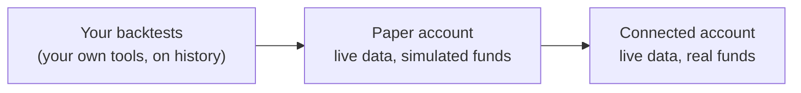

Plurex is built so that the strategy you forward test on paper is the strategy you run live. A paper account and a
connected account use the same operations, the same request and response models, the same errors and the same order
rules. Going live is a change of account, not a rewrite.



1. **Backtest** with your own tools and historical data. Plurex does not backtest; it provides the
   [market data](/guides/market-data), including candles, that you can feed into your own research.
2. **Forward test on paper.** Run the strategy unchanged against live order books, with fees and funding, until you
   trust its behaviour.
3. **Go live.** Connect an exchange account on the paper host's model host and point the strategy at it.

## What stays the same

| | Paper and live |
| --- | --- |
| Operations | Every `/hosts` query and command, both account streams, and the account operations |
| Models | The same `Order`, `Fill`, `Wallet`, `MarketPosition` and `AccountTransaction` shapes |
| Errors | The same error envelope and codes, such as `InsufficientFunds`, `Rejected`, `DuplicateClientOrderId`, `OrderAlreadyClosed` and `NotSupported` |
| Order rules | The same increments, minimums and value floors, validated the same way |
| Market data | The same live venue data |

## Make the switch

<Steps>
  <Step title="Find the model host">
    Read the paper host's `modelHostId` from [List hosts](/api-reference/platform/hosts/list). That is the real host
    your paper account has been simulating.
  </Step>
  <Step title="Connect an exchange account on it">
    Create an API key at the exchange and connect it with [Connect an account](/api-reference/platform/accounts/connect)
    using `modelHostId` as `hostId`. See [Connect an exchange account](/platform/add-exchange).
  </Step>
  <Step title="Re-read the live host's capabilities and markets">
    Read the model host's `capabilities` from List hosts and its market summaries from
    [List host markets](/api-reference/platform/hosts/list-markets). They are not identical to the paper host's; the
    checklist below says where they differ.
  </Step>
  <Step title="Swap the account ID">
    Point your strategy at the new account ID. Start small, and compare live fills with what paper produced.
  </Step>
</Steps>

## Differences to plan for

Paper simulates the market faithfully where it can and leaves out what it cannot. Each difference below is either
visible in the hosts' capabilities and market summaries, or listed here so you can plan for it.

### Leverage and liquidation

Paper trades perpetuals at 1× with no leverage setting, and never liquidates: losses take a balance negative instead.
Live perpetual markets usually have a leverage setting (`settings.leverage` on the market summary), and the exchange's
current leverage applies to your orders. Before your first live order, read it with
[Get leverage](/api-reference/platform/hosts/get-leverage) and set it with
[Set leverage](/api-reference/platform/hosts/set-leverage) where the market allows. Live positions can be liquidated,
so size them and manage margin with that in mind.

### Capabilities paper offers that the live host may not

The paper host provides some operations and options whatever its model host supports. Check the live host's
capabilities before relying on:

- the `ByClientOrderId` variants of order lookups and cancels, batch lookups, and the `Before` and `After` variants of
  [List closed orders](/api-reference/platform/hosts/list-closed-orders);
- [Cancel all orders](/api-reference/platform/hosts/cancel-all-orders);
- IOC and FOK on limit orders, and FOK on market orders (`supportedTimeInForce` in each order type's options);
- fill details on the order stream (`accountOrders.includesFillDetails`); without them, read executions with
  [List fills](/api-reference/platform/hosts/list-fills);
- the scope of a position mode change (`settings.positionMode.setEffectScope`); live, a change may apply to more than
  one market or the whole account.

### Capabilities the live host may offer that paper does not

- Notional-sized market orders on perpetuals. Paper perpetual market orders are sized in contracts only.
- Trigger reference prices paper cannot evaluate from live data. Compare the `trigger.referencePrice` options of each
  market's trigger order types on both hosts.
- Dated futures and option markets, which paper does not list.

### Fees and funding

Live fees follow your real exchange account: its tier, volume, promotions, fee-token discounts and the exchange's own
rules for which asset a fee is charged in. Paper charges the tier you selected, and charges spot fees in the quote
asset. Live funding settles at the exchange's own price; paper estimates it from the mark price at the funding time.
See [Fees and funding](/paper/fees-and-funding).

### Execution realism

Paper has no latency and no market impact beyond the visible book, and estimates queue position from visible size.
Expect live fills, especially passive fills and large sweeps, to differ. A live sweep across several price levels may
report several fills where paper reports one at the average price.

### Funds held by trigger orders

Paper reserves funds for a trigger order from the moment you place it. Some exchanges reserve nothing until the trigger
fires, so live, a waiting trigger may not reduce your available balance, and an order paper refused for lack of funds
may be accepted.

### Reduce-only orders

Paper rejects a reduce-only order that is larger than the position left to close. Some exchanges trim it to the
position size instead. Size reduce-only orders from the current position on both.

### Insufficient collateral on perpetuals

Paper rejects a perpetual order that its collateral cannot cover with `422 Rejected`. A live host may report the same
situation as `422 InsufficientFunds`. Handle both codes as "not enough funds or collateral".

### Transactions

Paper posts `Deposit`, `TradingFee`, `Settlement` and `FundingPayment` transactions. A live host reports its own set,
which may include types such as `Withdrawal`, `Transfer`, `BorrowInterest` or `LiquidationFee`, and may not report
some of paper's. Read `accountTransactions.supportedTransactionTypes`, and handle types you do not recognise.

### Transaction history and stream

A paper host offers transaction history and the transaction stream when its model host does, so this rarely changes
when you switch. Still check `accountTransactions.listTransactions` and
`accountTransactions.subscribeToAccountTransactions` on the live host, and fall back to polling List transactions where
there is no stream.

## Write strategies that adapt

The safest way to make the switch seamless is to never hard-code a host. Read the host's capabilities and the market's
order rules when the strategy starts, and choose behaviour from them. The same code then runs on paper and live.

```python
import requests

BASE = "https://api.plurex.io/api/v1"


def post(path, body, headers=None):
    response = requests.post(f"{BASE}/{path}", json=body, headers=headers or {})
    response.raise_for_status()
    return response.json()


def supported(support):
    return support["type"] in ("Supported", "PerMarket")


def load_profile(host_id, instrument):
    hosts = post("hosts/query/List", {})["items"]  # follow nextCursor in production
    host = next(h for h in hosts if h["id"] == host_id)
    markets = post("hosts/query/ListMarkets", {
        "hostId": host_id,
        "base": instrument["base"],
        "quote": instrument["quote"],
        "types": [instrument["type"]],
    })["items"]
    market = next(m for m in markets if m["instrument"] == instrument)
    caps = host["capabilities"]
    market_order = market["orderTypes"]["market"]
    trigger = market["orderTypes"]["triggerMarket"]

    return {
        "is_paper": host["isPaper"],
        "rules": market["orderTypes"]["limit"],
        # Size or Notional, whichever this market accepts for buys
        "market_buy_sizing": market_order["sizingSupport"]["buy"] if market_order else [],
        # Correlate orders by clientOrderId only where the host supports it
        "use_client_order_id": supported(caps["orders"]["submitOrder"]["clientOrderId"]),
        # Set leverage only where the market has a settable leverage
        "can_set_leverage": bool(market["settings"]["leverage"]
                                 and market["settings"]["leverage"]["setEffectScope"]),
        # Stream fills where details arrive with order events; otherwise poll ListFills
        "fills_on_stream": caps["accountOrders"]["includesFillDetails"],
        # Stream transactions where supported; otherwise poll ListTransactions
        "stream_transactions": supported(caps["accountTransactions"]["subscribeToAccountTransactions"]),
        # Stops: pick a reference price the market offers, rather than assuming one
        "stop_reference": choose_reference(trigger["trigger"]["referencePrice"]) if trigger else None,
    }


def choose_reference(policy, preferred=("Mark", "LastTrade", "Index")):
    if policy["type"] == "HostSelected":
        return None  # omit trigger.reference; the host uses policy["price"]
    return next((p for p in preferred if p in policy["prices"]), policy["prices"][0])
```

Run `load_profile` for the paper host while you forward test and for the model host when you go live. If a decision
your strategy depends on comes out differently, you find out at start-up rather than from a rejected order.

<Tip>
  Before going live, diff the two profiles. Anything that changed, such as sizing modes, reference prices or leverage,
  is a code path your strategy has not exercised on paper.
</Tip>
