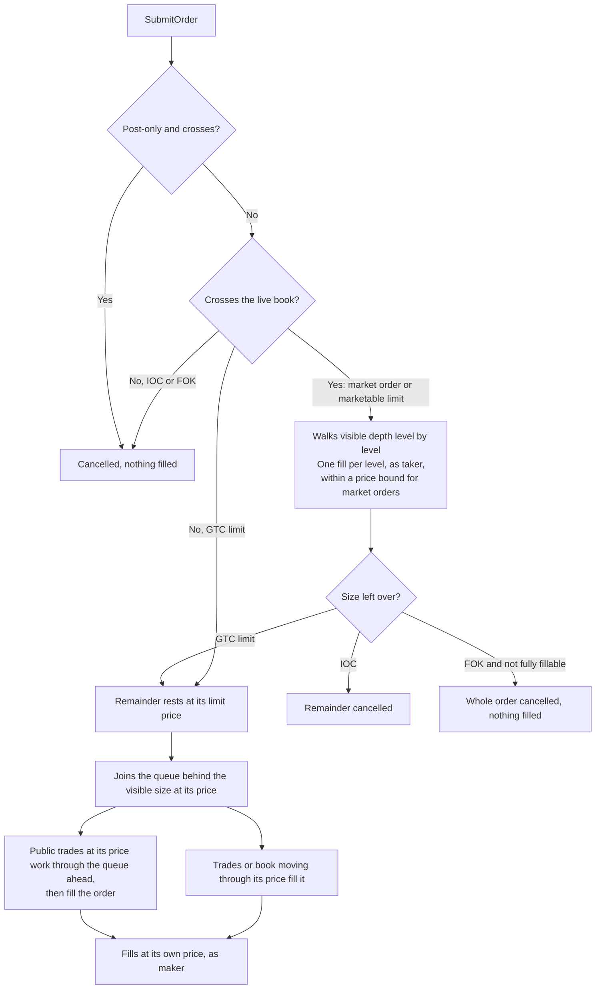

Paper trading runs your strategy against today's real market, with no capital at risk. A paper account trades on a
**paper host**, a simulation of a real host that models what decides a strategy's results, not only the fills. Because
it uses the same API as a real account, the code you test is the code you take live.

Run one paper account per variant to compare strategies, parameters or sizing side by side. Paper accounts trade
forward, in real time, on live data, so paper is the step between your own backtests and live trading. Plurex does not
replay history. When a strategy earns it, [switch the same code to a connected account](/paper/going-live).

## What paper simulates

| Area | What paper does |
| --- | --- |
| [Matching](#how-orders-fill) | Marketable orders walk the live order book, one fill per price level, with real slippage, and the depth you take is used up. Resting orders queue behind the visible size at their price and fill as live trades work through the queue. |
| [Trigger orders](#trigger-orders) | Stops and take-profits watch the live last trade, best bid or ask, mark or index price. |
| [Wallets and collateral](#positions-collateral-and-balances) | Balances are held and locked as on the host. Perpetual collateral is a weighted, multi-asset pool modelled on the host's account. |
| [Positions](#positions-collateral-and-balances) | Spot, linear and inverse perpetuals, in netting or hedging mode, with realised profit and loss, and unrealised profit and loss at the mark price. |
| [Leverage and margin](/paper/leverage-and-liquidation) | Leverage set per market within the model host's range, with margin held and locked at it. |
| [Liquidation](/paper/leverage-and-liquidation#what-happens-in-a-liquidation) | An account that falls to maintenance margin has its orders cancelled and its positions closed through the live book. |
| [Fees](/paper/fees-and-funding#trading-fees) | Maker and taker rates from the exchange's published fee tiers, including VIP tiers and rebates. |
| [Funding](/paper/fees-and-funding#perpetual-funding) | Perpetuals pay and receive funding at the venue's real funding times, from its finalised rates. |
| [Accounting](/paper/fees-and-funding#read-it-all-back) | Summed per asset, an account's transactions equal its wallet totals, so you can reconcile every balance. |
| [The API](#the-same-api-as-a-real-account) | Every host operation and both account streams, the same as a real account. |

## Paper hosts

A paper host is a host like any other. Discover the ones available to you with
[List hosts](/api-reference/platform/hosts/list) instead of hard-coding IDs such as `bybit-paper` or `valr-paper`.
These fields mark one out:

| Field | On a paper host |
| --- | --- |
| `isPaper` | `true` |
| `modelHostId` | The ID of the real host it simulates, its **model host** |
| `venueIds` | Exactly one venue: the venue whose live data it trades against |
| `supportedCredentialTypes` | `["Paper"]`: no exchange credentials needed |

Paper markets take their order rules from the model host: the same instruments, price and size increments, minimums,
value floors, and the same order types and order options where paper can simulate them. Paper simulates spot, linear
perpetual and inverse perpetual markets, so its market list can be smaller than the model host's. Read the paper
host's own markets with [List host markets](/api-reference/platform/hosts/list-markets) rather than assuming they
match. New listings, changed order rules and changed leverage ranges reach the paper host without any action from you.

A paper host publishes its own [capabilities](/capabilities/host-capabilities). It supports every order query and
cancel variant, fill lookup, transaction history and account stream whatever its model host offers, so you can
exercise your whole integration on paper. Read the paper host's capabilities while you paper trade, and the model
host's [before you go live](/paper/going-live).

### The same API as a real account

A paper account uses every `/hosts` operation, both account streams
([order changes](/api-reference/platform/hosts/subscribe-to-account-orders) and
[transactions](/api-reference/platform/hosts/subscribe-to-account-transactions)), and the account operations
[List](/api-reference/platform/accounts/list), [Get](/api-reference/platform/accounts/get),
[Rename](/api-reference/platform/accounts/rename) and [Delete](/api-reference/platform/accounts/delete). The only
operations specific to paper are [Create a paper account](/api-reference/platform/paper/create),
[Deposit](/api-reference/platform/paper/deposit), [Withdraw](/api-reference/platform/paper/withdraw) and the four
[fee tier operations](/paper/fees-and-funding).

A paper `clientOrderId` must be 1 to 64 characters of letters, digits, `-`, `_`, `.` or `:`; any other value returns
`422 ValidationFailed`. A live host applies its own rules. Paper returns `409 DuplicateClientOrderId` only while an open order
on the account holds the ID; once that order closes, the ID can be used again, and a lookup by client order ID returns
the newest order with it.

## Create and fund an account

<Steps>
  <Step title="Create the account">
    Call [Create a paper account](/api-reference/platform/paper/create) with your tenant ID, a name and the **paper
    host's** ID (not the model host's).

    ```json
    {
      "tenantId": "ten_abc",
      "name": "Momentum forward test",
      "hostId": "bybit-paper"
    }
    ```

    The new account starts with no balances and with the paper host's default fee tier, unless you pass a tier ID as
    `feeTier`; see [Fees and funding](/paper/fees-and-funding#choose-a-tier).

    A repeat creates a second account, so if the outcome is unclear, check
    [List accounts](/api-reference/platform/accounts/list) before retrying.
  </Step>
  <Step title="Deposit simulated funds">
    Call [Deposit](/api-reference/platform/paper/deposit) with the account ID, a positive amount and the asset. The
    response is the resulting wallet.

    ```json
    {
      "accountId": "acc_123",
      "amount": "10000",
      "asset": "USDT"
    }
    ```

    Each deposit posts a `Deposit` transaction, and a repeat deposits again. If the outcome is unclear, check
    [List transactions](/api-reference/platform/hosts/list-transactions), or compare the balance from
    [List wallets](/api-reference/platform/hosts/list-wallets), before retrying.
  </Step>
</Steps>

Deposit the asset your orders will spend or post as collateral:

| You want to | Deposit |
| --- | --- |
| Buy on a spot market | The quote asset, for example USDT for BTC/USDT |
| Sell on a spot market | The base asset, for example BTC for BTC/USDT |
| Trade a linear perpetual | An asset the model host counts as [collateral](/paper/leverage-and-liquidation#collateral), for example USDT |
| Trade an inverse perpetual | The base asset, for example BTC for an inverse BTC/USD perpetual, which settles and charges fees in base |

You can also create paper accounts and deposit in the [web app](/platform/accounts).

### Withdraw to set up a scenario

[Withdraw](/api-reference/platform/paper/withdraw) debits a paper account and returns the resulting wallet. Use it to
test how your strategy behaves with a low or empty balance. The request has the same shape as a deposit.

- Only the available balance can be withdrawn. Funds held by open orders or locked as position margin cannot, so
  cancel orders or close positions first.
- A withdrawal above the available balance, including from an asset the account does not hold, or above what an open
  position's loss or a debt leaves available, fails with `422 InsufficientFunds` and changes nothing.
- Each withdrawal posts a `Withdrawal` transaction with a negative amount, and a repeat withdraws again. If the outcome
  is unclear, check List transactions before retrying.

## How orders fill

Paper fills your orders against what the venue is actually showing, so your results reflect the visible depth and
queue. Every paper account is matched on its own: paper orders never use up each other's liquidity, and no
paper order touches the real market.



### Taking liquidity

A market order, or a limit order that crosses the book when it arrives, takes liquidity immediately. It walks the
opposite side of the live book level by level, as far as the visible depth allows, and gets one fill per price level,
at that level's price and with its own taker fee. Your code handles several fills per order, as it will live.

- **Market order protection.** When paper accepts a market order, it fixes the worst price the order may trade at: a
  little beyond the deepest level its size needs in the book at that moment. Size that cannot fill within that price
  is cancelled.
- **Depth you take is used up.** Your orders never reach the venue, so its book still shows liquidity you took. Paper
  matches your later orders against the book less the depth your account took, so a remainder or a quick second order
  cannot take the same liquidity twice. That depth is available to you again once the level leaves the book, or after
  a short time.

### Resting orders

A resting limit order joins the back of the queue, behind the size already visible at its price on its side of the
book. Your place then moves as the market does:

- Public trades at your price that hit your side of the book work through the queue ahead; once it has traded, further
  trades fill your order.
- When the visible size at your price shrinks, you move forward with it.
- A trade at a better price than yours, or opposite liquidity in the book at or through your price, fills the order
  directly.
- Your own resting orders share liquidity in price and time priority: best price first, then oldest.

A resting order always fills at its own limit price, as maker, at the maker rate, and can fill over many trades. The
[order stream](/guides/streams) sends a `Filled` update as the traded size grows; read each execution's price, size and
fee with [List fills](/api-reference/platform/hosts/list-fills).

### Time in force and order options

| Behaviour | What paper does |
| --- | --- |
| IOC order | Fills what the visible depth, or a market order's protected price, allows; the rest is cancelled. A partly filled order ends `Cancelled` with `sizeTraded` above zero. |
| FOK order | All or nothing. If visible depth cannot fill the whole size (at or better than the limit price, for a limit order), the order is cancelled with nothing filled. |
| GTC limit order | Any remainder rests on the book at the limit price. |
| IOC or FOK limit order that does not cross | Cancelled immediately |
| Post-only order that would cross on arrival | Cancelled, not filled |
| Reduce-only or `Close` order larger than the position left to close | Trimmed to what is left, in netting and hedging mode. Other open orders that would close the position count against what is left. |
| Trimmed closing order | Keeps its requested `size`. It ends `Filled` once the trimmed size trades, or `Cancelled` with what it traded if the position shrinks first. |
| Reduce-only order with nothing left to close, no position, or on the wrong side | Rejected with `422 Rejected` |
| Reduce-only market order to close a remainder below the market's minimum size | Request at least the minimum, and the order is trimmed to what is left. A request for exactly the remainder breaks the order rules. |
| Market order with no opposite liquidity | Rejected with `422 Rejected` |
| Order that partly fills and keeps resting | `Live`, with `sizeTraded` above zero |

Which options each market accepts is in its [order rules](/capabilities/order-rules), from
[List host markets](/api-reference/platform/hosts/list-markets).

### When market data drops

Paper never decides on stale data. If Plurex's live feed for a market drops, resting orders and triggers wait, and carry
on from the first fresh data. A crossed book then fills a resting order at its own price. Anything that came and went
in between is lost: paper does not invent missed fills or trigger crossings.

New orders still see the venue's current book. If it cannot be read, the submit returns `502 UpstreamFailure`; if it is
lost just after paper accepted the order, the order ends `Rejected` instead. Either way its funds are released.

## Trigger orders

Paper supports trigger limit and trigger market orders on markets where the model host offers them. A trigger watches
one reference price (last trade, best bid, best ask, mark or index) and fires when that price reaches or passes your
trigger price in the direction of the condition, `RefPriceGTE` or `RefPriceLTE`.

- Paper offers only the reference prices it can evaluate from the venue's live data. The `trigger` section of the
  paper market's `triggerLimit` and `triggerMarket` order rules shows which kinds are offered and whether you choose
  one (`UserSelectable`) or the host fixes it (`HostSelected`).
- A trigger whose condition is already met when you place it fires immediately.
- A fired trigger market order fills against the book like a market order. A fired trigger limit order crosses or rests
  like a limit order.
- **Funds are checked when the trigger fires.** A waiting trigger order holds nothing, so it does not reduce your
  available balance. When it fires, its order is checked against your balance, collateral and position at that moment,
  like a new order, and takes the fee rates in force then. If it cannot be accepted, it ends `Rejected` on the order
  stream.

Reduce-only trigger orders on perpetuals make stop-loss and take-profit orders, and a full-size stop-loss and
take-profit can wait side by side. They are not linked: once one closes the position, the other is rejected when it
fires, so cancel it yourself.

## Positions, collateral and balances

### Wallets

Each asset has one wallet with a total and an available balance. Open orders hold funds and open positions lock them;
what is held or locked is not available to new orders or withdrawals. You can deposit any asset.

**Spot.** A buy holds quote and a sell holds base while the order is open. A buy's hold includes its fee at the higher
of your maker and taker rates, and a market buy is held at its protected worst price. What fills do not use is released
when the order ends. An order the balance cannot cover, fee included, returns `422 InsufficientFunds`. A spot fill
posts two `Trade` transactions, the asset received and the asset paid, and its fee as `TradingFee`.

### Collateral on perpetuals

Perpetuals share one cross collateral pool, modelled on the model host's account, and trade at the leverage you set per
market. Opening risk needs margin at that leverage plus the order's fee, and an order that needs more collateral than
is available is rejected with `422 InsufficientFunds`. See [Leverage and liquidation](/paper/leverage-and-liquidation).

### Positions and profit and loss

- Linear and inverse perpetuals each use their own contract maths: see [Contract details](/capabilities/order-rules#contract-details-what-a-size-means).
- Realised profit and loss posts to the settlement asset as a `Settlement` transaction on every fill that reduces or
  closes a position.
- [List open positions](/api-reference/platform/hosts/list-positions) and Get market state report each open leg's
  `markPrice` and its `unrealizedPnl` at that price, in the settlement asset, before fees and funding.
- Losses, fees and funding can take a balance negative, which counts against your available collateral. An account that
  falls to maintenance margin is [liquidated](/paper/leverage-and-liquidation#when-liquidation-starts).
- A closing order is never refused for lack of funds.

### Position mode

New perpetual positions start in netting mode. Where a market offers hedging, switch with
[Set position mode](/api-reference/platform/hosts/set-position-mode) while the market is flat and has no open orders.
In netting mode, an order larger than the position closes it and opens the other way. In hedging mode, long and short
legs are independent, each with its own entry price, profit and loss, fees, funding and margin.

In hedging mode every order must set `positionEffect`: `Open` adds to the leg on the order's side, and `Close` reduces
the opposite leg. Paper rejects an order without it with `422 Rejected`.

## What paper does not simulate

Paper simulates what a trader sees and relies on, not the institution behind it. These are its limits, so you know how
to read your results.

| Not simulated | What happens instead |
| --- | --- |
| Risk tiers | Maintenance margin and maximum leverage stay the same at every position size. Exchanges tighten both as a position grows, so paper can allow a large position, above all in an illiquid market, that a live host would refuse or liquidate sooner. |
| Insurance funds, auto-deleveraging, bankruptcy prices | Liquidations fill at real book prices, and a loss beyond the account is [written off](/paper/leverage-and-liquidation#losses-beyond-the-account). |
| Liquidation on every tick | Paper checks accounts repeatedly, not on every price change, so at high leverage a close can come later and at a worse price than an exchange's. |
| Borrowing, interest and isolated margin | Not available |
| Dated futures and options | Not listed on paper hosts |
| Resets | Create a new account to start fresh; use Withdraw to lower a balance |
| Volume-based fee tiers, promotions, fee-token discounts | You select a fee tier manually |
| Configurable latency | Paper adds no artificial delay, and you cannot set one. Orders see the real latency of Plurex and live market data. |
| Market impact beyond your own fills | Paper holds back the depth your account takes while the book still shows it, but does not model how other traders react to your orders. |
| Hidden liquidity and venue-specific queue rules | Queue position is estimated from visible size and public trades. |
| Venue limits beyond the order rules | Paper applies the market's published order rules, not an exchange's price bands or maximum order sizes. Its market order protection is its own and can differ from the exchange's. |
| Self-trade prevention | Your own orders never trade with each other. |

## Next steps

<CardGroup cols={2}>
  <Card title="Leverage and liquidation" icon="gauge" href="/paper/leverage-and-liquidation">
    Set leverage, read margin and see when positions close.
  </Card>
  <Card title="Fees and funding" icon="percent" href="/paper/fees-and-funding">
    Choose a fee tier and follow funding payments.
  </Card>
  <Card title="From paper to live" icon="rocket" href="/paper/going-live">
    What stays the same and what to plan for.
  </Card>
  <Card title="Quickstart" icon="play" href="/quickstart">
    Place your first paper order in a few minutes.
  </Card>
</CardGroup>
