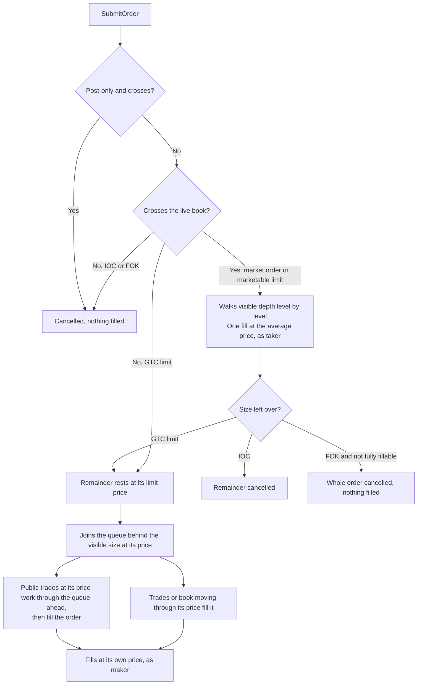

Paper trading lets you run a strategy against today's real market without risking money. A paper account trades on a
**paper host**: a simulation of a real host that matches your orders against the venue's live order book and public
trades, charges trading fees, pays and receives perpetual funding, and keeps positions and balances, all with simulated
funds.

Use it as the step between your own backtests and live trading. Your backtests tell you how a strategy behaved on
history; paper trading shows how it behaves in the market as it is now, with live depth, real queues and real funding.
When you are ready, you switch the same code to a connected account. See
[From paper to live](/paper/going-live).

<Note>
  Plurex does not replay history or run backtests. Paper accounts trade forward, in real time, on live data.
</Note>

## Paper hosts

A paper host is a host like any other. You find it with [List hosts](/api-reference/platform/hosts/list), and these
fields mark it out:

| Field | On a paper host |
| --- | --- |
| `isPaper` | `true` |
| `modelHostId` | The ID of the real host it simulates, its **model host** |
| `venueIds` | Exactly one venue: the venue whose live data it trades against |
| `supportedCredentialTypes` | `["Paper"]`: no exchange credentials needed |

Paper markets take their order rules from the model host: the same instruments, price and size increments, minimums,
value floors, and the same order types and order options where paper can simulate them. Paper simulates spot, linear
perpetual and inverse perpetual markets, so its market list can be smaller than the model host's. Always read the
paper host's own markets with [List host markets](/api-reference/platform/hosts/list-markets) rather than assuming
they match.

A paper host publishes its own [capabilities](/capabilities/host-capabilities). In some places it offers more than the
model host (for example extra order queries, time in force options or fill details on the order stream) and in some
places less (no leverage control, for one). Read the paper host's capabilities while you paper trade, and the model
host's before you go live.

<Tip>
  Host IDs such as `bybit-paper` and `valr-paper` appear in examples, but discover the paper hosts available to you
  with [List hosts](/api-reference/platform/hosts/list) instead of hard-coding them.
</Tip>

### The same API as a real account

Once created, a paper account is an ordinary account. It uses:

- every `/hosts` operation: orders, fills, wallets, positions, margin states, market state, position mode and
  transactions, as the paper host's capabilities allow;
- both account streams, [order changes](/api-reference/platform/hosts/subscribe-to-account-orders) and
  [transactions](/api-reference/platform/hosts/subscribe-to-account-transactions), where the host supports them;
- the account operations [List](/api-reference/platform/accounts/list), [Get](/api-reference/platform/accounts/get),
  [Rename](/api-reference/platform/accounts/rename) and [Delete](/api-reference/platform/accounts/delete).

The only operations specific to paper are [Create a paper account](/api-reference/platform/paper/create),
[Deposit](/api-reference/platform/paper/deposit) and the three [fee tier operations](/paper/fees-and-funding).

## Create and fund an account

<Steps>
  <Step title="Create the account">
    Call [Create a paper account](/api-reference/platform/paper/create) with your tenant ID, a name and the **paper
    host's** ID (not the model host's).

    ```json
    {
      "tenantId": "ten_abc",
      "name": "Momentum forward test",
      "hostId": "bybit-paper"
    }
    ```

    The response is the new account, with `isPaper: true`. It starts with no balances and with the default fee tier;
    see [Fees and funding](/paper/fees-and-funding) to choose another.

    Creating an account is not safe to repeat: a repeat creates a second account. If the outcome is unclear, check
    [List accounts](/api-reference/platform/accounts/list) before retrying. If your plan's paper-account limit is
    reached, the call returns `422 AccountLimit`.
  </Step>
  <Step title="Deposit simulated funds">
    Call [Deposit](/api-reference/platform/paper/deposit) with the account ID, a positive amount and the asset. The
    response is the resulting wallet.

    ```json
    {
      "accountId": "acc_123",
      "amount": "10000",
      "asset": "USDT"
    }
    ```

    Each deposit posts a `Deposit` transaction. Deposits are not safe to repeat. If the outcome is unclear, check
    [List transactions](/api-reference/platform/hosts/list-transactions) where the paper host's
    `accountTransactions.listTransactions` is supported, or compare the balance from
    [List wallets](/api-reference/platform/hosts/list-wallets), before retrying.
  </Step>
</Steps>

Deposit the asset your orders will spend or post as collateral:

| You want to | Deposit |
| --- | --- |
| Buy on a spot market | The quote asset, for example USDT for BTC/USDT |
| Sell on a spot market | The base asset, for example BTC for BTC/USDT |
| Trade a linear perpetual | A collateral asset, typically the quote or settlement asset, for example USDT |
| Trade an inverse perpetual | The base asset, for example BTC for an inverse BTC/USD perpetual, which settles and charges fees in base |

There are no withdrawals and no reset. To start again from a clean slate, create a new paper account. You can also
deposit and create paper accounts in the [web app](/platform/overview).

## How orders fill

Paper fills your orders against what the venue is actually showing. Every paper account is matched on its own: paper
orders never use up each other's liquidity, and no paper order touches the real market. Each account sees what its
orders would have done if it were the only one trading alongside the real market.



### Taking liquidity

A market order, or a limit order that crosses the book when it arrives, takes liquidity immediately. It walks the
opposite side of the live book level by level, as far as the visible depth allows, and is reported as one fill at the
volume-weighted average price of the levels it took. Large orders therefore see realistic slippage across the visible
depth.

- **IOC**: whatever the visible depth cannot fill is cancelled. A partly filled order ends `Cancelled` with
  `sizeTraded` above zero.
- **FOK**: all or nothing. If visible depth cannot fill the whole size (at or better than the limit price, for a
  limit order), the order is cancelled with nothing filled.
- **GTC limit**: the remainder rests on the book at the limit price.

### Resting orders

When a limit order rests, it joins the back of the queue: paper notes the size already visible at its price on its
side of the book. Public trades at that price work through the queue ahead first; once that size has traded, further
trades fill your order. A trade at a better price than yours, or opposite liquidity in the book at or through your
price, fills the order directly.

A resting order always fills at its own limit price, as maker, and is charged the maker rate. It can fill over many
trades; each fill arrives on the order stream with its details.

### Time in force and order options

| Behaviour | What paper does |
| --- | --- |
| Limit time in force | GTC, IOC and FOK |
| Market time in force | IOC (the default) and FOK |
| Post-only order that would cross on arrival | Cancelled, not filled |
| IOC limit order that does not cross | Cancelled immediately |
| FOK limit order that does not cross | Cancelled immediately |
| Reduce-only order larger than the position left to close | Rejected with `422 Rejected`, not trimmed |
| Reduce-only order with no position, or on the wrong side | Rejected |

Which options each market accepts is in its order rules. Read them from
[List host markets](/api-reference/platform/hosts/list-markets) and see [Order rules](/capabilities/order-rules).

### What is not modelled

- **Latency.** Submissions, cancels and triggers act instantly against the latest data paper has observed.
- **Market impact beyond the visible book.** Paper does not deplete the book after your order takes from it, so
  orders in quick succession each see the same visible liquidity until the venue's book updates.
- **Hidden liquidity and venue-specific queue rules.** Queue position is estimated from visible size and public
  trades.
- **Fills per level.** A sweep across several levels is reported as one fill at the average price, where a live venue
  may report several.
- **Amending orders.** Cancel and resubmit instead.

## Trigger orders

Paper supports trigger limit and trigger market orders on markets where the model host offers them. A trigger watches
one reference price (last trade, best bid, best ask, mark or index) and fires when it crosses your trigger price in
the direction of the condition, `RefPriceGTE` or `RefPriceLTE`.

- Paper offers only the reference prices it can evaluate from the venue's live data, and evaluates exactly the kind
  the order uses. Read the `trigger` section of the paper market's `triggerLimit` and `triggerMarket` order rules to
  see which kinds are offered and whether you choose one (`UserSelectable`) or the host fixes it (`HostSelected`).
- Every live value is checked in order, so a brief cross is not missed. A trigger whose condition is already met when
  you place it fires immediately.
- A fired trigger market order fills against the book like a market order. A fired trigger limit order crosses or rests
  like a limit order.
- **Funds are held from submission.** A waiting trigger order reserves the funds or collateral it needs, so it counts
  against your available balance before it fires.

Reduce-only trigger orders on perpetuals make stop-loss and take-profit orders.

## Positions, collateral and balances

**Spot.** A buy holds quote and a sell holds base while the order is open; a cancel releases the hold. Fills move the
balances. Spot trades do not post `Settlement` transactions; their fees post as `TradingFee`.

**Perpetuals.** Paper trades perpetuals at 1×, without leverage:

- Opening risk needs collateral equal to the position's value. An order that needs more collateral than is available
  is rejected with `422 Rejected`. (On spot, an order the balance cannot cover returns `422 InsufficientFunds`.)
- Collateral can be several assets. Non-stable assets such as BTC count at a discount to their value. Unrealised
  losses reduce what you can open; unrealised profit does not add to it. Read
  [List margin states](/api-reference/platform/hosts/list-margin-states) and
  [Get market state](/api-reference/platform/hosts/get-market-state) for the current total and available collateral.
- There is no liquidation. Losses, fees and funding can take a balance negative. A negative balance blocks new risk but
  never blocks reducing or closing a position: a closing order is never refused for lack of funds.
- Realised profit and loss posts as `Settlement` transactions.

**Position mode.** New perpetual positions start in netting mode. Where a market offers hedging, switch with
[Set position mode](/api-reference/platform/hosts/set-position-mode) while the market is flat and has no open orders.
In netting mode, an order larger than the position closes it and opens the other way. In hedging mode, long and short
legs are independent, each with its own entry price, profit and loss, fees and funding.

In hedging mode every order must set `positionEffect`: `Open` adds to the leg on the order's side, and `Close` reduces
the opposite leg. Paper rejects an order without it with `422 Rejected`.

[Get leverage](/api-reference/platform/hosts/get-leverage) and [Set leverage](/api-reference/platform/hosts/set-leverage)
are not supported on paper hosts, every paper market's `settings.leverage` is `null`, and market state reports the
leverage setting as `Disabled`.

## Continuity

Your paper account is kept safe across restarts. Balances, positions, fills, fees and funding already posted, open
orders and waiting triggers all survive, with their original prices and fee terms. Resting orders and triggers resume
from fresh live data.

Paper never invents activity for periods without live data: no fills or trigger crossings are made up for a gap, and trades a venue re-sends after a reconnect are not counted twice.

Two things to plan for:

- While a paper host is starting, its operations return `503 Unavailable`. Retry after a short wait.
- Paper does not pause when a venue's feed is interrupted, so it may accept orders during an interruption.

If a command's outcome is unclear, reconcile as you would on a live venue: [Get an order](/api-reference/platform/hosts/get-order)
or [List open orders](/api-reference/platform/hosts/list-orders) for orders,
[List transactions](/api-reference/platform/hosts/list-transactions) (where supported) or
[List wallets](/api-reference/platform/hosts/list-wallets) for deposits, and
[List accounts](/api-reference/platform/accounts/list) for account creation.

## What paper does not simulate

| Not simulated | What happens instead |
| --- | --- |
| Leverage | Perpetuals trade at 1× collateral |
| Liquidation, maintenance margin, auto-deleveraging | Balances can go negative; closing is never blocked |
| Borrowing, interest and isolated margin | Not available |
| Dated futures and options | Not listed on paper hosts |
| Withdrawals, transfers and resets | Create a new account to start fresh |
| Volume-based fee tiers, promotions, fee-token discounts | You select a fee tier manually |
| Latency and market impact | Orders act instantly against the visible book |

## Next steps

<CardGroup cols={3}>
  <Card title="Fees and funding" icon="percent" href="/paper/fees-and-funding">
    Choose a fee tier and follow funding payments.
  </Card>
  <Card title="From paper to live" icon="rocket" href="/paper/going-live">
    What stays the same and what to plan for.
  </Card>
  <Card title="Quickstart" icon="play" href="/quickstart">
    Place your first paper order in a few minutes.
  </Card>
</CardGroup>
