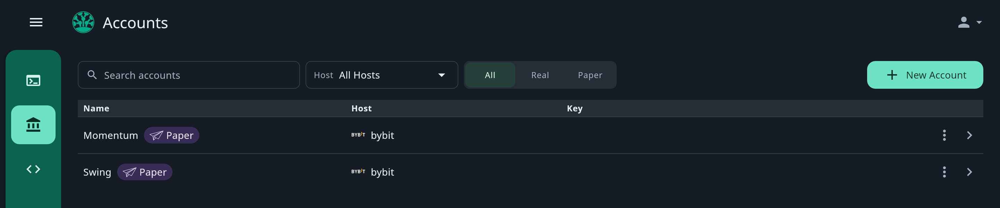
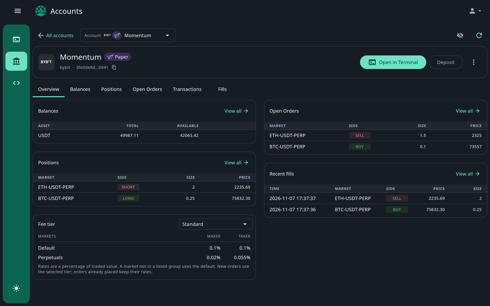

**Accounts** lists the selected [organisation's](/platform/organisations) trading accounts that you can see. Search them by name, filter by host, and show **All**, **Real** or **Paper**.

<Frame>
  
</Frame>

## Add an account

**New Account** adds one, and shows only if you can connect or create accounts: choose a host, and whether the account is real or paper.

- **Paper**: needs no credentials, and starts with no balances. See [Paper trading](/paper/overview).
- **Real**: connects your exchange account with an API key you create at the exchange. See
  [Connect an exchange account](/platform/add-exchange).

## Review an account

Open an account to see its **Overview**, **Balances**, **Positions**, **Open Orders**, **Transactions** and **Fills**.
The overview shows a summary of each, with **View all** to open the full list. Positions show each side's liquidation
price where the host reports one.

<Frame>
  
</Frame>

The account's ID is under its name, with a copy button: use it as the `accountId` in the API.

## Manage an account

| Action | Where | Does |
| --- | --- | --- |
| **Open in Terminal** | The account page | Trades the account in the [Terminal](/platform/terminal). |
| **Deposit** | A paper account's page | Adds simulated funds of an asset you choose. |
| **Fee tier** | A paper account's overview | Chooses the paper fee tier. New orders use it; orders already placed keep their rates. See [Fees and funding](/paper/fees-and-funding). |
| **Update connection** | A real account's page, or **Update credentials** in its menu in the list | Replaces the exchange credentials when you rotate the key at the exchange. See [Rotate credentials](/platform/add-exchange#rotate-credentials). |
| **Rename** | The account's menu | Changes its name. |
| **Delete** | The account's menu | Removes the account from Plurex. |

<Warning>
  Deleting an account removes it from Plurex and breaks the history records of trading activity that used it. You
  cannot undo a delete.
</Warning>
