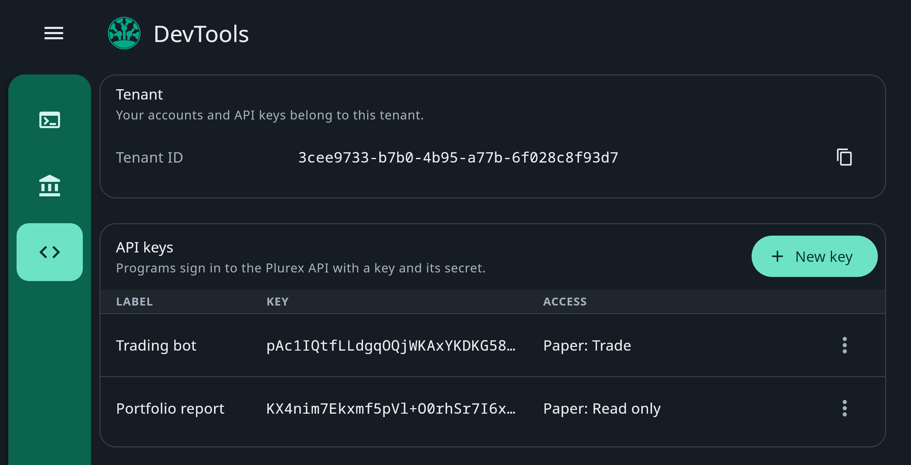
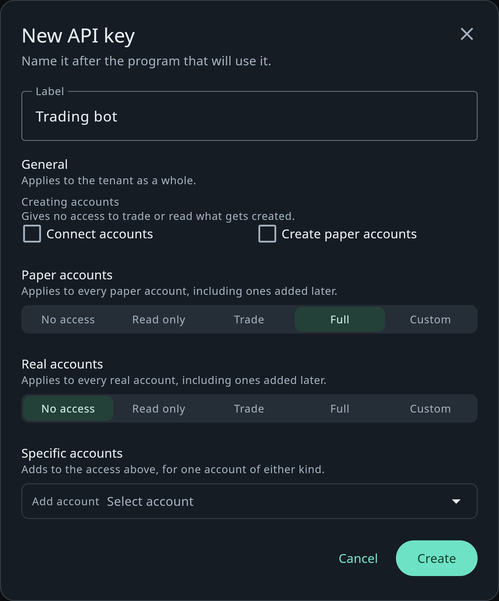
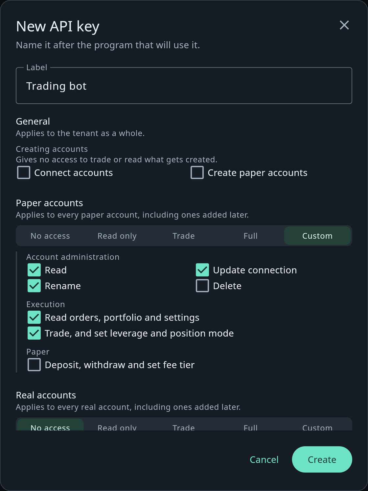
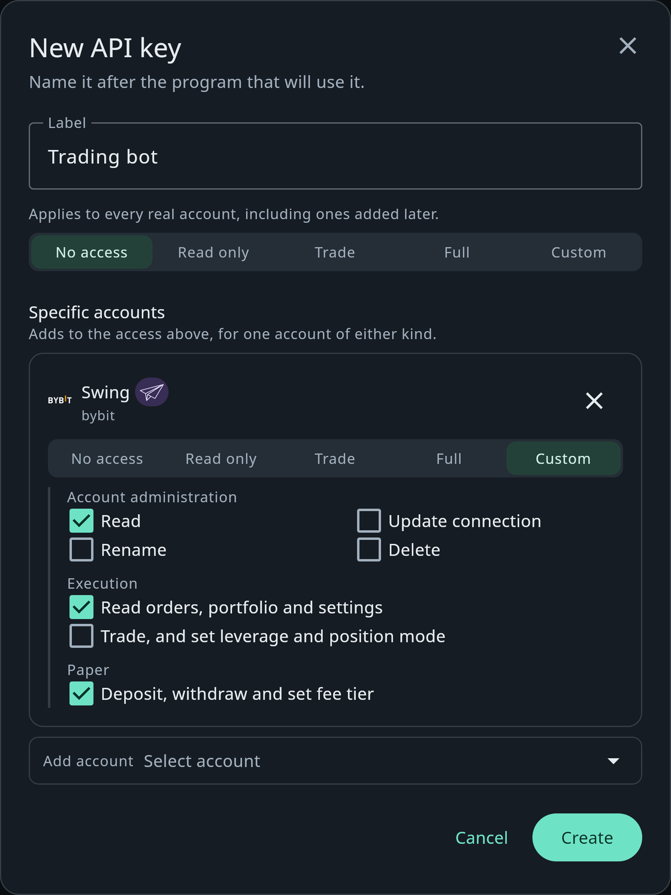

Programs sign in to the [Plurex API](/authentication) with an API key and its secret. You create keys on the
**DevTools** page, and for each key you choose what it can do: a research script can read your paper accounts and
nothing else, a bot can trade them without being able to fund itself, and no key reaches a real account until you
say so.

## DevTools

Open **DevTools** from the sidebar. It shows:

- your **Tenant ID**, with a copy button. Your accounts and API keys belong to this tenant, and tenant-wide operations
  such as [List accounts](/api-reference/platform/accounts/list) take it;
- **API keys**: each key's label, its public key, and a summary of its access, such as `Paper: Trade` or
  `Paper: Read only · Real: Trade · 2 accounts`.

<Frame>
  
</Frame>

Each key's menu has **Copy key**, **Edit access** and **Delete**.

## Create a key

<Steps>
  <Step title="Start a new key">
    Choose **New key** and give it a **Label** named after the program that will use it, such as `Trading bot`.
  </Step>
  <Step title="Choose its access">
    A new key starts with **Trade** on paper accounts and **No access** to real accounts. Change it as described
    below. You can edit it later.
  </Step>
  <Step title="Create it">
    Choose **Create**. If two-factor authentication is on, enter your 6-digit code.
  </Step>
  <Step title="Save the key and secret">
    Copy the **Key** and the **Secret** into a secrets manager or your program's configuration. The secret is shown only
    once and cannot be recovered; if you lose it, delete the key and create another.
  </Step>
</Steps>

## Choose what a key can do

The access editor has four sections. Everything starts off, access only adds, and a key can do something if any section
allows it.

<Frame>
  
</Frame>

| Section | Applies to |
| --- | --- |
| **General** | Your tenant as a whole: whether the key can connect exchange accounts and create paper accounts. |
| **Paper accounts** | Every paper account, including ones added later. |
| **Real accounts** | Every real account, including ones added later. |
| **Specific accounts** | One account, of either kind, on top of the sections above. |

### Presets

Paper accounts, real accounts and each specific account take a preset:

| Preset | Account administration | Execution | Paper |
| --- | --- | --- | --- |
| **No access** | None | None | None |
| **Read only** | Read | Read orders, portfolio and settings | None |
| **Trade** | Read | Read, and trade | None |
| **Full** | Read, rename, update connection and delete | Read, and trade | Deposit, withdraw and set fee tier |
| **Custom** | Any combination of the permissions below | | |

Only **Full** manages a paper account's balance and fee tier, so a key with **Trade** cannot give itself funds. A
combination that matches no preset shows as **Custom**.

### Permissions

Choose **Custom** to set each permission yourself:

<Frame>
  
</Frame>

| Group | Permission | Lets the key |
| --- | --- | --- |
| Account administration | **Read** | See the account: [Get an account](/api-reference/platform/accounts/get), and the account in [List accounts](/api-reference/platform/accounts/list). |
| | **Rename** | [Rename](/api-reference/platform/accounts/rename) the account. |
| | **Update connection** | Replace a real account's exchange credentials with [Update connection](/api-reference/platform/accounts/update-connection). |
| | **Delete** | [Delete](/api-reference/platform/accounts/delete) the account. |
| Execution | **Read orders, portfolio and settings** | Read orders, fills, transactions, wallets, positions, margin, market state, leverage and position mode, including the [account order](/api-reference/platform/hosts/subscribe-to-account-orders) and [transaction](/api-reference/platform/hosts/subscribe-to-account-transactions) streams, and a paper account's [fee settings](/api-reference/platform/paper/get-fee-settings) and [effective rates](/api-reference/platform/paper/get-effective-fee-rates). |
| | **Trade, and set leverage and position mode** | [Submit](/api-reference/platform/hosts/submit-order) and cancel orders, and [set leverage](/api-reference/platform/hosts/set-leverage) and [position mode](/api-reference/platform/hosts/set-position-mode). |
| Paper | **Deposit, withdraw and set fee tier** | [Deposit](/api-reference/platform/paper/deposit), [withdraw](/api-reference/platform/paper/withdraw) and [set the fee tier](/api-reference/platform/paper/set-fee-tier). Shown for paper accounts only. |
| General | **Connect accounts** | [Connect](/api-reference/platform/accounts/connect) an exchange account. |
| | **Create paper accounts** | [Create a paper account](/api-reference/platform/paper/create). |

Administration and execution are separate: renaming or deleting an account shows nothing of its orders or balances, and
trading it does not let the key rename or delete it. Any access to an account also lets the key see it in List accounts
and Get an account.

**Trade** includes leverage and position mode because they decide how an order trades. There is no cancel-only
permission.

### Specific accounts

Under **Specific accounts**, choose **Add account** and pick an account. It is added with **Read only**, in a card of
its own, and you can give it any preset or a custom set. Remove it with the **×** on its card.

<Frame>
  
</Frame>

Access to a specific account adds to what its kind already allows; it cannot take anything away. Here the key keeps its
paper access everywhere, and on the account Swing it can also deposit, withdraw and set the fee tier. To keep a key to a
few accounts, leave **Paper accounts** and **Real accounts** at **No access** and add the accounts one by one.

### Accounts a key creates

**Connect accounts** and **Create paper accounts** give no access to what gets created. A key that creates paper
accounts and then trades them needs access through **Paper accounts**, which covers paper accounts added later. A key
with only the creation permissions can create an account but cannot read or trade it.

## Typical keys

| The program | Access |
| --- | --- |
| A forward test that creates, funds and trades its own paper accounts | **Create paper accounts**, and **Full** on paper accounts |
| A bot trading paper accounts you fund yourself | **Trade** on paper accounts |
| A report or dashboard | **Read only** on the accounts it reports on |
| A bot trading one exchange account | **Trade** on that account under **Specific accounts**, and **No access** elsewhere |
| A program that only reads market data | **No access** everywhere |

Every key can read market data and discover hosts and markets, with no access granted.

## Edit or delete a key

**Edit access** opens the same editor for an existing key. A change applies from the key's next request, so a program
can keep the same key and secret. **Delete** removes the key: programs using it stop working at once, and it cannot be
undone. Both need your 6-digit code when two-factor authentication is on, as creating a key does.

Only you, signed in to the web app, can create, edit or delete keys. A key cannot change its own access or create
another key.

## Keep keys safe

- Create one key per program, with only the access it needs, so you can revoke one without stopping the others.
- Keep the secret on your own servers: never in browser or mobile code, and never in source control.
- Keys do not expire. Delete a key you no longer use, and replace one you think has leaked.
- [Turn on two-factor authentication](/platform/settings#two-factor-authentication), so a stolen password cannot create
  or widen a key.

When a key lacks access, the API answers `404 AccountNotFound` for an account the key cannot see at all, and
`403 Forbidden` for an action it is not allowed on an account it can see. See [Authentication](/authentication#access).
