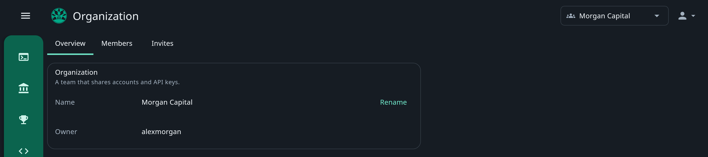
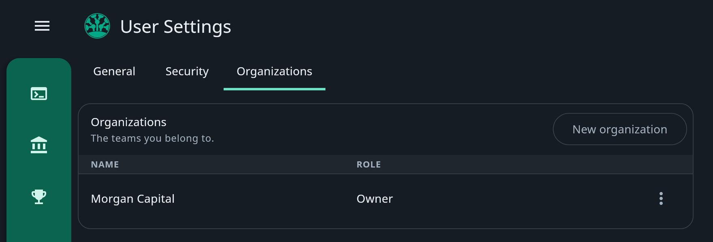
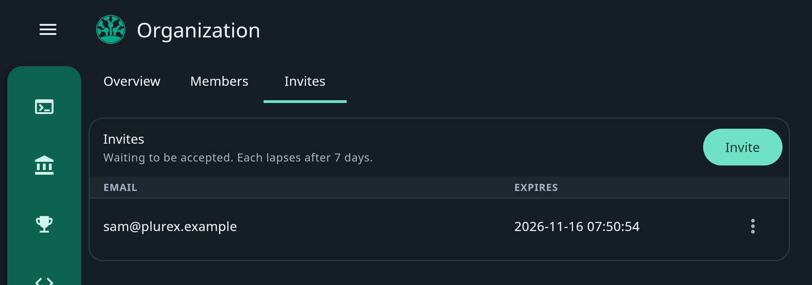
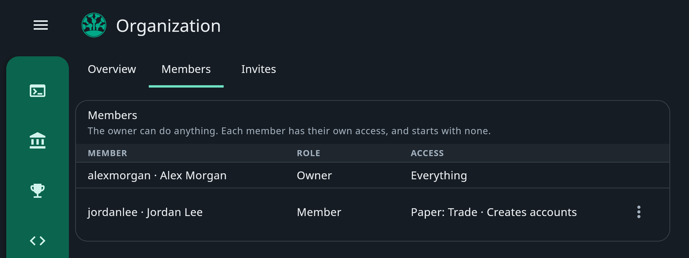
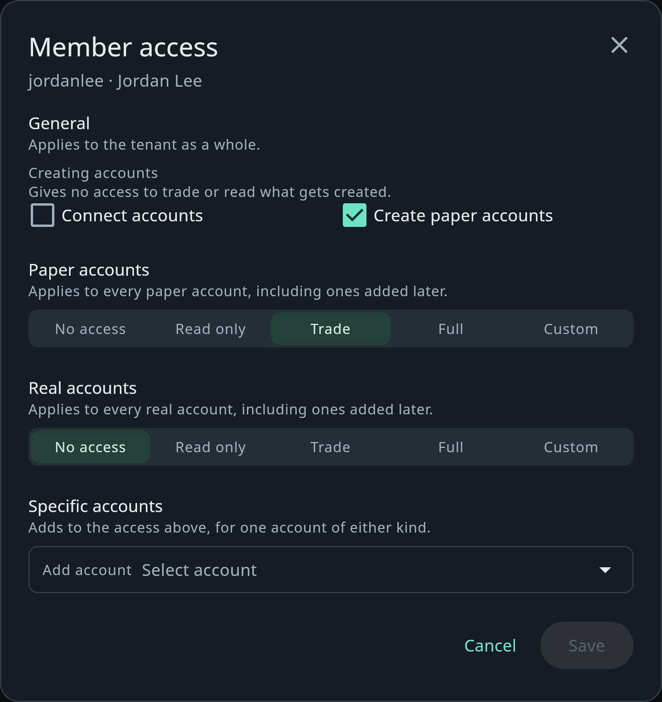

An **organisation** lets a team share its trading setup: the same accounts, the same API keys, one tenant ID. The owner
invites the members and decides what each one can do, with the same controls as an [API key](/platform/api-keys). A
researcher can watch every account, a trader can trade the paper accounts and reach nothing real, and only the owner
manages the API keys.

There are two kinds of **tenant**: you, and organisations. Each has its own tenant ID, accounts and API keys, and
nothing is shared between them. Your own accounts and keys stay yours when you join or create an organisation.

## Work as yourself or in an organisation

Once you belong to an organisation, a switcher at the top right picks the tenant you work as: **Personal** for
yourself, or an organisation by name. The Terminal, Accounts and DevTools all show the selected tenant's accounts,
keys and tenant ID. While an organisation is selected, the sidebar also has a page named after it, the **Organization**
page.

<Frame>
  
</Frame>

## Create an organisation

<Frame>
  
</Frame>

<Steps>
  <Step title="Start">
    Open **User Settings** from the menu at the top right, then **Organizations**, and choose **New organization**.
  </Step>
  <Step title="Name it">
    Enter a name of 3 to 50 letters, digits, spaces, dashes or underscores, and choose **Create**. You own the new
    organisation, and the app selects it and opens its page.
  </Step>
</Steps>

**Organizations** lists the organisations you belong to, with your role in each. Each one's menu has **Open**, which
selects it, and **Leave** for organisations you do not own.

## Owner and members

| Role | Can |
| --- | --- |
| **Owner** | Everything: every account, the API keys, renaming the organisation, its members and its invites. Whoever creates the organisation owns it, and cannot leave it or be removed. |
| **Member** | Only what the owner gives them. A new member has no access. |

Every member sees the **Overview** tab, with the organisation's name and owner. Only the owner sees **Members** and
**Invites**, and only the owner can **Rename** the organisation.

## Invite a member

<Frame>
  
</Frame>

<Steps>
  <Step title="Send the invite">
    On the **Invites** tab, choose **Invite**, enter the person's email address and choose **Send invite**.
  </Step>
  <Step title="They join">
    They get an email with a link. They open it, sign in or create an account with that same address, and choose
    **Join**. They can also **Decline**.
  </Step>
  <Step title="Give them access">
    They join with no access. Give them some from the **Members** tab, as below.
  </Step>
</Steps>

An invite is for one email address, so someone without a Plurex account can sign up with that address to accept it.
Someone who already has an account there also finds the invite under **User Settings**, **Organizations**, in
**Invites to you**, with **Join** and **Decline**.

Each invite lapses after 7 days. To send a new link, invite the same address again: the old link stops working.
**Cancel invite**, in the invite's menu, stops its link at once. You cannot invite someone who is already a member.

## Give a member access

<Frame>
  
</Frame>

**Members** lists each member with their role and a summary of their access. To change a member's access, choose
**Edit access** in their menu. The **Member access** editor works exactly like an API key's: the same
[sections, presets and permissions](/platform/api-keys#choose-what-a-key-can-do), applied to what the member can do in
the app. Choose **Save**, and enter your 6-digit code if two-factor authentication is on.

<Frame>
  
</Frame>

A member has only the access you give them, exactly as a key does. The member above can create paper accounts and
trade every paper account, and reaches nothing real.

The app shows a member only what their access allows. **Accounts** lists only the accounts they can see, **New Account**
shows only if they can connect or create accounts, and an account's **Rename**, **Delete**, **Deposit** and **Update
connection** show only if they are allowed. In the Terminal, an account they can see but not trade is view-only.

## API keys in an organisation

The organisation's API keys belong to the organisation, and only its owner can create, edit or delete them on
**DevTools**. Members see the tenant ID there but not the keys. A member whose program needs the API asks the owner for
a key with the access it needs, so the owner decides what every program can reach.

Because keys belong to the organisation, removing a member does not stop any key.

## Remove or leave

- **Remove a member:** on **Members**, choose **Remove** in their menu. They lose access to the organisation's accounts.
- **Leave:** choose **Leave** on the **Overview** tab, or in the organisation's menu under **User Settings**,
  **Organizations**. Only a new invite from the owner brings you back.

The owner cannot leave or be removed.
