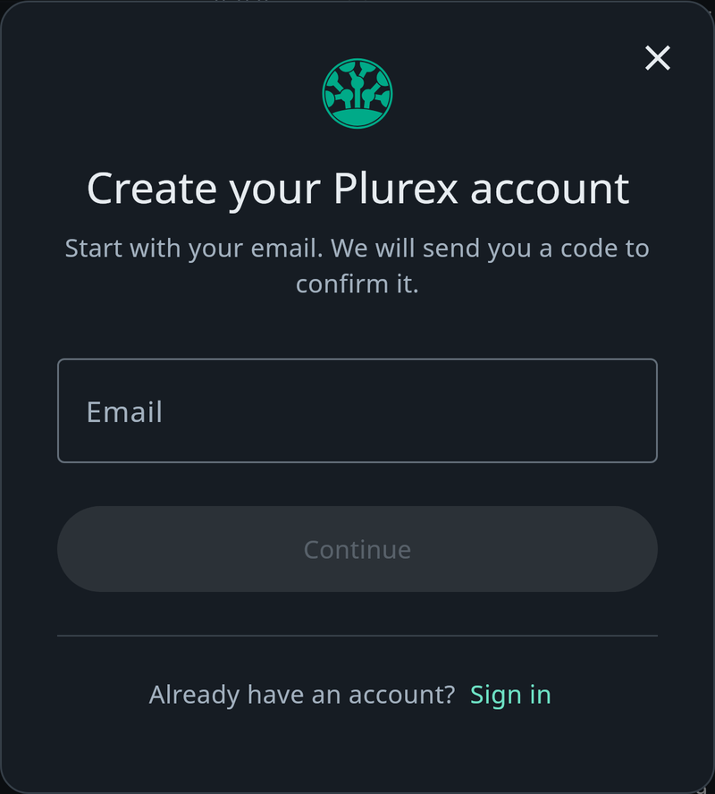

The [Plurex web app](https://platform.plurex.io) is where you set up everything the API needs, and where you trade and
check your accounts by hand. It works on the same accounts, orders and balances as the [API](/quickstart), so anything
you do in one shows up in the other. To automate a strategy, use the API.

## Find your way around

The sidebar has the app's pages, and the menu at the top right has **User Settings** and **Logout**. Once you belong to
a team, a switcher beside the menu picks the [organisation](/platform/organisations) you work in, and every page shows
that organisation's accounts and keys.

| Page | What it is for |
| --- | --- |
| [Terminal](/platform/terminal) | Trade one market at a time, with its chart, order book and trades. The app opens here. |
| [Accounts](/platform/accounts) | Your real and paper accounts: add them, fund paper accounts, and review balances, positions, orders and history. |
| [DevTools](/platform/api-keys) | Your tenant ID and the API keys your programs sign in with, with the access each key has. |
| [Organization](/platform/organisations) | Shown while a team is selected, under the team's name: its members, their access and its invites. |
| [User Settings](/platform/settings) | Your email, password and two-factor authentication, and your organisations. |

The button at the bottom of the sidebar switches between dark and light mode. Without signing in, the Terminal shows
markets, charts and order books; signing in adds trading and your accounts.

## Sign up

<Frame>
  
</Frame>

<Steps>
  <Step title="Enter your email">
    Open the [web app](https://platform.plurex.io), choose **Sign in**, then **Create account**. Enter your email and
    choose **Continue**.
  </Step>
  <Step title="Confirm it">
    Enter the 6-digit code from the email. You can ask for a new one.
  </Step>
  <Step title="Choose a handle and password">
    Choose a handle, one word of letters and numbers that others see, and a password of at least 8 characters. Accept
    the Terms and Conditions and the Privacy Policy, then choose **Create account**. You are signed in.
  </Step>
</Steps>

Signing up also creates **Personal**, your own [organisation](/platform/organisations): the tenant that owns your API
keys and trading accounts. To share them with a team, create another organisation and invite its members.

## Sign in

Sign in with your email and password, and with a code from your authenticator app if
[two-factor authentication](/platform/settings#two-factor-authentication) is on.

If you forget your password, choose **Forgot password?** to get a reset link by email, and set a new one from it. See
[Settings and security](/platform/settings#reset-a-forgotten-password).

## Next steps

<CardGroup cols={2}>
  <Card title="API keys and access" icon="key" href="/platform/api-keys">
    Create a key for each program, with only the access it needs.
  </Card>
  <Card title="Accounts" icon="building-columns" href="/platform/accounts">
    Add a paper account or connect an exchange account.
  </Card>
  <Card title="Terminal" icon="chart-candlestick" href="/platform/terminal">
    Trade a market by hand.
  </Card>
  <Card title="Organisations and members" icon="users" href="/platform/organisations">
    Share accounts and API keys with a team.
  </Card>
  <Card title="Settings and security" icon="shield-halved" href="/platform/settings">
    Turn on two-factor authentication.
  </Card>
</CardGroup>
