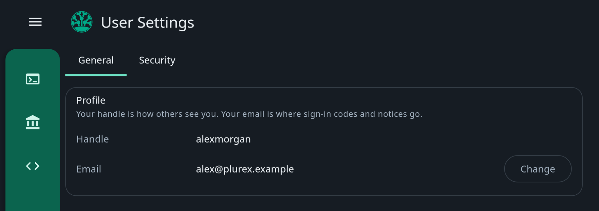
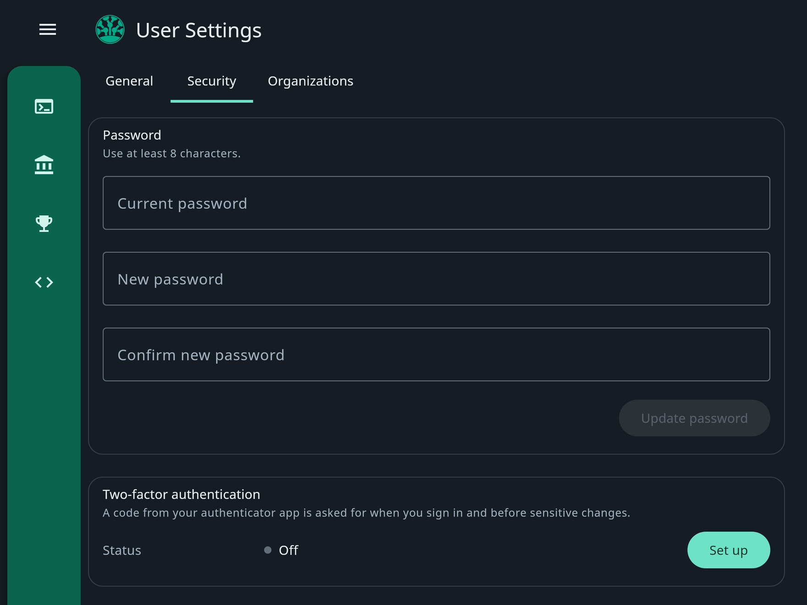

**User Settings**, in the menu at the top right, has three tabs: **General** for your profile, **Security** for your
password and two-factor authentication, and **Organizations** for your [organisations](/platform/organisations).

## Profile and email

<Frame>
  
</Frame>

**General** shows your **Handle** and **Email**. Your email is where sign-in codes and security notices go. To change
it, choose **Change**, enter your password and the new address, and confirm the 6-digit code sent to the new address.
You also need a code from your authenticator app if two-factor authentication is on.

## Password

<Frame>
  
</Frame>

To change your password, enter the current one and the new one, at least 8 characters, then choose **Update password**.

## Two-factor authentication

With two-factor authentication on, the app asks for a 6-digit code from your authenticator app when you sign in and
before sensitive changes, such as creating, editing or deleting an [API key](/platform/api-keys), changing a member's
access or changing your email.

<Steps>
  <Step title="Start">
    On **Security**, choose **Set up** and enter your password.
  </Step>
  <Step title="Scan the code">
    Scan the QR code with an authenticator app, such as Google Authenticator or Authy.
  </Step>
  <Step title="Confirm">
    Enter the 6-digit code the app shows. The status changes to **On**.
  </Step>
</Steps>

**Turn off** removes it, after a code from your authenticator app.

If you lose your authenticator app and cannot sign in, raise a
[support ticket](https://support.plurex.io/portal/en/newticket).

## Reset a forgotten password

On the sign in dialog, choose **Forgot password?** and enter your email. Plurex emails a reset link; open it, choose a
new password and sign in with it.

## When your login changes

- **You are told about changes.** A change of password, email or two-factor authentication sends a notice to your email,
  to the old address for an email change.
- **Other sessions end.** The same changes sign you out everywhere except where you made them.
