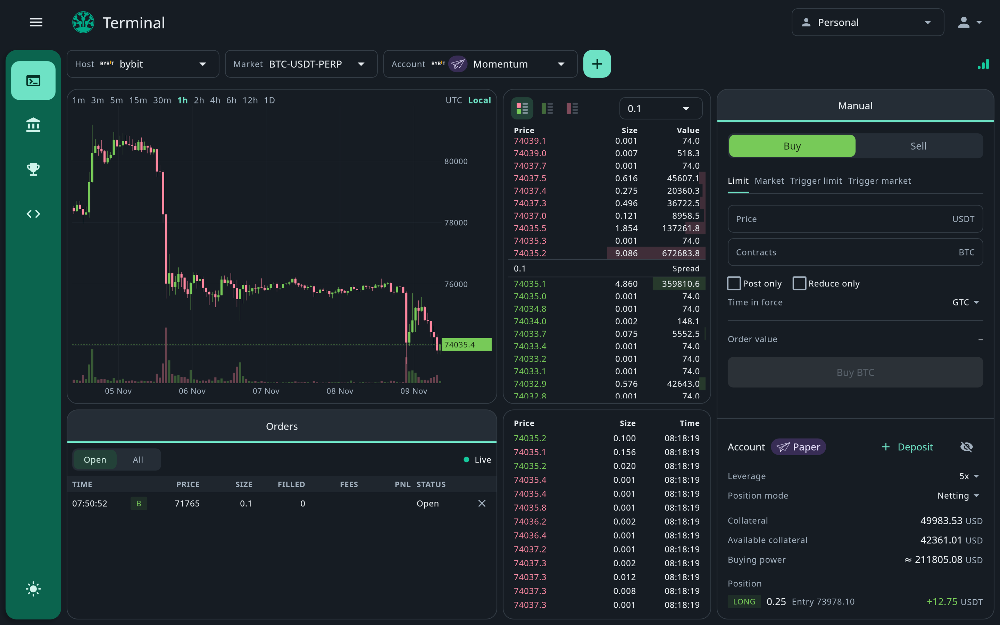

**Terminal** is the app's home: a trading screen for one market at a time. Choose a **Host**, a **Market** and an
**Account** on that host.

<Frame>
  
</Frame>

## Market data

- A live candlestick **chart** of the traded price, with volume: pick an interval, pan and zoom through history, and
  label times in UTC or your local time zone.
- The live **order book**, with price grouping and a choice of bids and asks, both or one side.
- The **trade feed** of the market's public trades.

The icon at the top right shows the health of the Terminal's live connections.

## Place orders

The **Manual** panel places **Limit**, **Market**, **Trigger limit** and **Trigger market** orders, sized in contracts
or by notional as the market allows, with time in force, post-only, reduce-only and position effect where the market
offers them. It checks your order against the market's [order rules](/capabilities/order-rules), the same rules the API
enforces, and shows the order's value before you send it.

Under the order form, the account panel shows your collateral, what is available and your buying power, and your
position on the market with its entry price, unrealised profit and loss and, where the host reports one, its
liquidation price. On markets that have them, it has the **Leverage** and **Position mode** controls. For a paper
account, **Deposit** adds simulated funds.

On an account you can see but not trade, the order form is replaced by a note that the account is view-only.

## Orders

**Orders** lists the market's orders on the account, live as they change. **Open** shows the orders still open, which
you can cancel with **×**; an order's status reads **Pending** until the host reports it working. **All** adds completed
ones. Orders paper placed to [liquidate a position](/paper/leverage-and-liquidation) are marked.

If the selected host cannot trade the market, or paper trading is not available on it, the Terminal tells you so.
